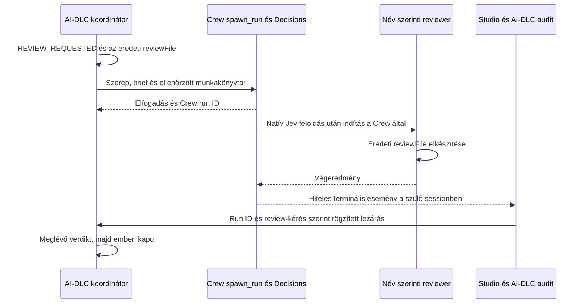

# AI-DLC delegálás a Crew natív Jev modellválasztásával

**2026-11-22 · Végleges technikai terv jóváhagyásra.** A viszonyítási alap Kiro Crew 0.13.0, Kiro CLI 2.37.0 / KAS 0.66.70, AI-DLC Studio 2.0.1 (`8b3881d…`) és a csomagolt AI-DLC 2.11.3 (`a8721be3…`). A sorrendet, a fájlokat és az átvételi feltételeket a [megvalósítási terv](NATIVE_DECISIONS_IMPLEMENTATION_PLAN.md) rögzíti.

## Két egymásra épülő fázis

| Fázis | Hatókör | Átvehető eredmény |
| --- | --- | --- |
| **I. Crew** | A `subagent_parts/model_choice.py::_route_unpinned_start()` guardjából töröljük az `or info.agent` sort. A teszt a Crew saját `spawn_run` eszközén indul, Studio és AI-DLC nélkül. | Offline igazolt precedencia és egy külön jóváhagyott Hosted Jev próba. A név szerinti worker profilja megmarad, és a KAS igazolja a tényleges modellt. |
| **II. AI-DLC** | Az I. fázis átvétele után a Studio közös `spawn_run` szabályt kap. Az első bekötés a `domain-design` szakaszban kizárólag az `aidlc-architecture-reviewer-agent`. | Egy eredeti AI-DLC review-kéréshez egy Crew-futás tartozik. A valódi befejezésből az AI-DLC a saját review-fájlját és verdiktjét rögzíti, majd a meglévő emberi kapun folytatja. |

A normál indítás továbbra is **Kiro Crew: Start**. A koordinátor a szülő sessionből hívja a Crew meglévő managed MCP eszközét. Az AI-DLC gondoskodik a szerepről, a briefről, a workflow állapotáról, a jogosultságokról és a kapukról. A Crew gondoskodik a modellfeloldásról, a futtatásról, a sorról és a terminális állapotról.

## I. A Crew forrásában már létező út

1. A `spawn_run` az aktív szülő sessionhöz köti a nevet és a `task` szöveget, majd a meglévő gateway és indítási ellenőrzések adják át a kérést a runnernek. A `_selection_kind()` a név szerint megadott agentet sablonként választja ki. A név megmarad egészen a tényleges worker indításáig. [MCP hívás](https://github.com/kirodotdev/KiroCrew/blob/v0.13.0/src/kiro_crew/mcp_tools/spawn.py#L210) · [Sablonválasztás](https://github.com/kirodotdev/KiroCrew/blob/v0.13.0/src/kiro_crew/subagent_parts/start_pricing.py#L73)
2. A gyári `_route_unpinned_start()` a név jelenlétekor kihagyja a routingot. Az egy feltétel törlése után a meglévő `routed_spawn_model()` az engedélyezett briefet a szülő session katalógusával és kiinduló modelljével értékeli. Ehhez kell a `decisions.model_route_derive`, a működő Hosted Jev és az adott végpontra adott tulajdonosi `tool_args` consent. A pilot alapértelmezett KAS backendjét a gateway választja. [Guard](https://github.com/kirodotdev/KiroCrew/blob/v0.13.0/src/kiro_crew/subagent_parts/model_choice.py#L83) · [Natív döntési pont](https://github.com/kirodotdev/KiroCrew/blob/v0.13.0/src/kiro_crew/decisions/points/model_route.py#L996)
3. Az `info.routed_model` a `_sharing_plan()` meglévő sorrendjében a kézi `model` és a `subagent` szerepmodell után következik. A konkrét modell külön worker sessionbe kerül, amelynél KAS-on a Crew a `model` session opciót állítja. Az alkalmazást a backend által visszaadott modellazonosító és a futás terminális `resolvedModel` mezője igazolja. [Modell átadása](https://github.com/kirodotdev/KiroCrew/blob/v0.13.0/src/kiro_crew/subagent_manager/run_turn.py#L334) · [KAS modellopció](https://github.com/kirodotdev/KiroCrew/blob/v0.13.0/src/kiro_crew/acp/session_handle_model_selection.py#L407)

A helyi pilotban használt név szerinti profilok modellpin nélküliek. A meglévő explicit modell, `model="auto"`, szerepmodell, backend override, Crew tagként indítás és folytatás megtartja az eredeti elsőbbségét. A router bekapcsolása a telepítés összes egyébként jogosult név szerinti indítására vonatkozik. Ha nincs alkalmazható döntés, ugyanaz a már elfogadott Crew-futás a normál modellfeloldással folytatódik. Az effort a Crew meglévő beállításából érkezik.

## II. Közös hívási szabály és az eredmény visszaadása

A telepített AI-DLC a kiosztásokat a koordinátornak adja át a stage és protokoll leírásokban. A meglévő `skills/aidlc/SKILL.md` Kiro szakaszában legyen egy közös Crew szabály, amelyre az átvezetett hívóhelyek hivatkoznak. A `kiroDispatch()` felismeri a pontos managed MCP eszközazonosítót, majd a meglévő AI-DLC ellenőrzésekhez adja a szerepet és a briefet. A PreToolUse hook engedélyezi vagy tiltja a hívást. A hívandó eszközt a koordinátor választja ki a protokollból. [AI-DLC hívóhelyek és hookok](research/AI_DLC_CREW_ROUTING_INTEGRATION_2026-11-22.md#belépési-pontok-az-ai-dlc-ben)

A `spawn_run` nyugta elfogadást vagy várakozást igazol. A sikeres befejezés a kötött Studio slot `role="subagent"` sorából, a `meta.subagentCompletion` mezőből olvasható ki. A `HostBridge.recent_rows()` ehhez explicit `roles=("subagent",)` szűréssel hívható. A közös visszaút az eredeti AI-DLC célhoz köti a Crew run ID-t. Review esetén a pontos `requestId`, reviewer, `reviewFile` és a fájl lenyomata adja a `review --verdict` meglévő, manifestet és source állapotot is ellenőrző útjának bemenetét. A stage kaput az AI-DLC nyitja meg. [Crew completion mezők](https://github.com/kirodotdev/KiroCrew/blob/v0.13.0/src/kiro_crew/subagent_completion_meta.py#L37) · [Studio HostBridge](https://github.com/warren830/kirocrew-app-aidlc/blob/8b3881d4737399c3394d8d187f102a5c95d6e528/backend/studio/sessions.py#L350)

A pilot után ugyanez az indító és futásazonosító kötés használható a developer, lead, pipeline, ensemble, mob, wave, Unit review és swarm útvonalain. A protokollok továbbra is saját sorrendjüket, artefaktumaikat, jogosultságaikat és kapuikat adják. A `spawn_run` batch munkakönyvtára közös, ezért egy másik worktree ugyanennek az eszköznek külön hívása. Az inline lépésekben eleve a koordinátor dolgozik.

## Ami már igazolt és ami átvételre vár

- **Korábban megfigyelt.** A CrewLab natív KAS útján külön specialisták, egy tényleges architecture review és emberi jóváhagyások működtek. A teljes projektprofil átadása és a tényleges worker modell nem volt igazolható. [CrewLab audit](CREWLAB_TRIAL_REPORT.md#2-agent-delegation-and-effective-settings)
- **Forrásból igazolt.** A név szerinti kizárás, a modell tényleges sessionig vezető útja és a strukturált completion már a Crew része. A projektből töltött KAS profil viszont elhagyja többek között a `resources`, `allowedTools`, `toolsSettings` és `includeMcpJson` mezőket. A hookok owner consenthez kötöttek. Az eredeti jogokat és a szükséges szabályok elérését a tényleges workerben kell igazolni. [KAS profilfeloldás](https://github.com/kirodotdev/KiroCrew/blob/v0.13.0/src/kiro_crew/acp/harness/kas.py#L352)
- **A pilotban igazolandó.** A Studio koordinátor effektív `spawn_run` grantje, a Crew worker workflow kötése, az eredeti review-fájlhoz tartozó hiteles befejezés és a meglévő emberi kapu. A két helyi kompatibilitási korlát a CrewLab `cwd` engedélyezése és a `task` 5000 karakteres határa. A konkrét ellenőrzések és a visszaállás a [megvalósítási tervben](NATIVE_DECISIONS_IMPLEMENTATION_PLAN.md) szerepelnek.
