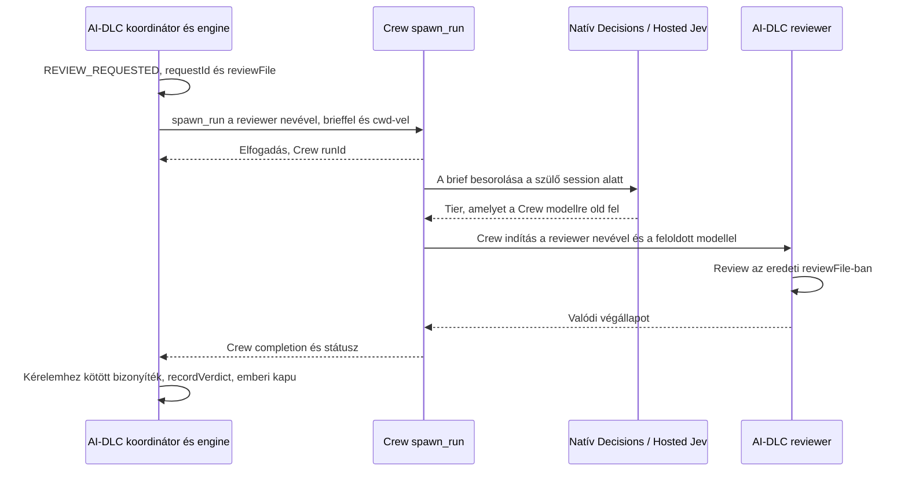

# Közös AI-DLC specialistakiosztás natív Crew Decisions használatával

**2026-11-22 · Forrás alapján egyszerűsített architektúra.** Az első célpont egy valódi, külön indított AI-DLC tervreviewer. A [megvalósítási terv](NATIVE_DECISIONS_IMPLEMENTATION_PLAN.md) tartalmazza a javasolt egysoros Crew-változtatást, a Studio bekötését és az átvételhez szükséges bizonyítékot.

## Ajánlott megoldás

**A saját Crew 0.13.0 telepítésünkhöz a javasolt futási változtatás egyetlen feltétel törlése.** A `subagent_parts/model_choice.py::_route_unpinned_start()` guardjából vegyük ki az `or info.agent` sort. Így a meglévő `spawn_run(agent=…, task=…, cwd=…)` hívásban a specialista neve megmarad, és a Crew a natív `model.route` döntést az adott feladathoz is alkalmazhatja. A meglévő MCP-séma, gateway és futtató szolgálja ki a hívást.

**A hatókör a saját telepítés.** Az itt használt név szerinti agentprofilokon nincs rögzített modell, így külön profilmodell-ellenőrzés helyett elég a meglévő `info.model` és `agent.role_models['subagent']` guard. A `decisions.model_route_derive` a telepítés minden egyébként alkalmas név szerinti indítására kiterjed. A Studio oldali bekötés elsőként a `domain-design` önálló review-kérésére vonatkozik.

## A natív indítási út a forrásban

- A `spawn_run` már átadja az agentnevet, briefet, cwd-t és az esetleges kézi `model` és `reasoning_effort` mezőket a gatewaynek. A `_selection_kind()` a névvel megadott agentet sablonként kezeli. A név elhagyása másik agentprofilt eredményezhet. A stock 0.13.0 modellválasztása az `info.agent` miatt áll meg; a név szerinti indítást konfigurációval önmagában nem lehet bevonni. [MCP séma](https://github.com/kirodotdev/KiroCrew/blob/v0.13.0/src/kiro_crew/mcp_tools/spawn_parts/schemas.py#L271) · [Agent kiválasztása](https://github.com/kirodotdev/KiroCrew/blob/v0.13.0/src/kiro_crew/subagent_parts/start_pricing.py#L73) · [Routing guard](https://github.com/kirodotdev/KiroCrew/blob/v0.13.0/src/kiro_crew/subagent_parts/model_choice.py#L83)
- A meglévő `routed_spawn_model()` a briefet a szülő session kulcsával, élő providerével és modellkatalógusával dolgozza fel. A pilot feltétele a Hosted Jev beállítása, a `decisions.model_route_derive` és a tulajdonosi `tool_args` consent. A pilot a gateway alapértelmezett KAS backendjén fusson. Egy külön backendválasztás a szülőn vagy a hívásban a megmaradó guard miatt kihagyhatja a döntést. A modellmező maradjon el, ha routingot kérünk. A hívásban szereplő `model="auto"` is átugorja a Jev ágat, és a backend választását kéri. [A natív döntéshívás](https://github.com/kirodotdev/KiroCrew/blob/v0.13.0/src/kiro_crew/decisions/points/model_route.py#L996) · [Backend öröklése](https://github.com/kirodotdev/KiroCrew/blob/v0.13.0/src/kiro_crew/dashboard/messaging_api/spawn.py#L617)
- A natív döntés `info.routed_model` mezője a `_sharing_plan()` modellválasztásába kerül. A sorrend kézi modell → `subagent` szerepmodell → routing eredménye. A konkrét override külön worker sessiont kap, és a providerhez már a meglévő úton jut el. KAS-on a Crew a `model` session opciót állítja. A specialista neve megmarad, az effortot a Crew külön kezeli. Az alkalmazott modellt a KAS session és a terminális `resolvedModel` igazolhatja. [Modellprioritás](https://github.com/kirodotdev/KiroCrew/blob/v0.13.0/src/kiro_crew/subagent_manager/run_start.py#L124) · [Worker indítása](https://github.com/kirodotdev/KiroCrew/blob/v0.13.0/src/kiro_crew/subagent_manager/run_turn.py#L334) · [KAS modellopció](https://github.com/kirodotdev/KiroCrew/blob/v0.13.0/src/kiro_crew/acp/session_handle_model_selection.py#L407)
- A Decisions REST útjai beállítást, consentet, állapotot és visszajelzést kezelnek. A SageMaker-próba egy kötött tesztkérdés. Nincs olyan támogatott MCP, REST vagy App SDK művelet, amelyik a valódi szülősession és worker modellkatalógusa alatt egy tetszőleges specialistabriefre futtatható modell ID-t ad. A Crew forrása technikailag importálható egy megbízható host appból, de a natív caller, provider, admission és státusz belső határait ekkor az adapternek kellene összekötnie. Az App Spawn SDK és az app-tokenes REST indítás saját apphoz kötött agentet, illetve szülőt enged. A managed `strictSession` app tool deklaráció a csomagolt első fél eszközeinek felülete. A Studio manifestjébe írt új deklaráció önmagában nem kapja meg ezt a kötést. [Decisions route-ok](https://github.com/kirodotdev/KiroCrew/blob/v0.13.0/src/kiro_crew/dashboard/routes/system.py#L240) · [App határ az indításnál](https://github.com/kirodotdev/KiroCrew/blob/v0.13.0/src/kiro_crew/dashboard/messaging_api/spawn.py#L509) · [Managed app tool](https://github.com/kirodotdev/KiroCrew/blob/v0.13.0/src/kiro_crew/apps/app_agent_tools.py#L109)

## Felelősség és visszatérés

| Gazda | Felelősség |
| --- | --- |
| AI-DLC engine és Studio | A brief, szerep, stage rules, jogosultság, review-kérés, fájl, `recordVerdict` és az emberi kapu. Egy közös protokoll köti a kérés azonosítóját a Crew-futáshoz. |
| Crew `spawn_run` és Decisions | Hiteles szülő, admission, natív `model.route`, indítás és futási állapot. A hívás nyugtája a queue elfogadását vagy az indítást igazolja. |
| AI-DLC eredményillesztés | Az eredeti `requestId` és a valódi Crew `runId` egyezése, terminális siker, reviewerazonosság és az eredeti `reviewFile` lenyomata. Újranyitáskor az ismert futáshoz tér vissza. |

A koordinátor meglévő PreToolUse útja ellenőrzi a konkrét Crew MCP-hívást és az eredeti review-kérést. A PostToolUse nyugta a run ID társítására használható. A valódi befejezéshez a Crew a szülő sessionbe `subagent_completion` eseményt küld `meta.subagentCompletion` mezővel. A Studio meglévő `HostBridge.recent_rows()` függvénye ki tudja olvasni a kötött session metaadatait. A Studio ezt a jelzést illeszti az eredeti AI-DLC audithoz és review-fájlhoz. Az eredeti `recordVerdict` és emberi kapu így ugyanazt a kérést dolgozza fel. A hiteles metaadat tényleges eljutása az auditig és a reviewer jogosultságai a pilot átvételi feltételei. [Crew completion mezők](https://github.com/kirodotdev/KiroCrew/blob/v0.13.0/src/kiro_crew/subagent_completion_meta.py#L37) · [Külön KAS review és AI-DLC audit](CREWLAB_TRIAL_REPORT.md)

A natív routing a Crew-futás elfogadása után történik. Ha a döntés hiányzik, hibás vagy az örökölt modellt tartja meg, ugyanaz a Crew-futás a normál modellfeloldással folytatódik. Elfogadott vagy bizonytalan indítás esetén a Studio a meglévő futást egyezteti a review-kéréssel. Az eredeti KAS `subagent` út külön visszaállítási lehetőség a következő kéréshez, a Studio kötésének visszaállításával.

## KAS, Crew és a hívóhelyek

| Út | Döntés és teljes munkaköltség |
| --- | --- |
| Natív KAS `subagent` | A meglévő AI-DLC indítás, hookok és eredménykezelés itt igényelné a legkevesebb munkát, ha volna hívásonkénti konkrét modellátadás. A telepített Kiro CLI 2.37.0 / KAS 0.66.70 név szerinti `subagent_<név>` wrapperében ilyen mező nincs. Az `invoke_sub_agent` feltételes `modelCategory` mezője KAS-kategóriát fogad. A motor a regisztrált profil modelljét tudja használni, a Crew KAS-projekciója ezt a mezőt külön kihagyja. A permission-válasz engedélyez vagy tilt. A saját profilváltozatok és a szülő modelljének átmeneti állítása szerep-, versenyhelyzet- és jogosultsági problémát hozna. A natív út adja a dokumentált visszaállást. Egy támogatott per-child model override kevesebb eredményillesztést igényelhetne. |
| Crew `spawn_run(agent=…, model=…)` | Patch nélküli futtatási és eredményátadási próba kézi modellel. Így külön mérhető a szerep, a jogosultság és az eredeti review-kérés lezárása. |
| **Crew `spawn_run`, egy guard törlésével** | **Ajánlott a saját telepítéshez.** A Crew meglévő routingja, indítása és completionje használható a név szerinti profilhoz. A Studio módosítása a review indítására és lezárására szorítkozik. |
| `spawn_sub_agents`, session/work-dispatch, Dynamic Workflows, App Spawn SDK | A blocking tool telepített sémájából hiányzik ez a konkrét modellparaméter. A session/work-dispatch és a Dynamic Workflows saját végrehajtási állapotot kérne az AI-DLC mellé. Az App Spawn SDK az app saját agentjeit indítja, eltérő parent- és jogosultsági úton. Studio Advisor, illetve a parent chat `Auto (decision model)` beállítása más döntési helyet fed le. |

A Kiro újabb `updatedInput` dokumentációja a választott tool sémáján belüli módosítást írja le. A pilot a telepített verziók viselkedésén alapul. A korábbi négy valódi CrewLab natív specialistaindítás `modelId=auto`, `modelOverride=false`, `effortOverride=false` értéket mutatott. A kiszolgáló konkrét modelljét és az egyedi worker fogyasztását ebből nem ismerjük. [Kiro hook](https://kiro.dev/docs/hooks/types/#pre-tool-use) · [KAS-projekció](https://github.com/kirodotdev/KiroCrew/blob/v0.13.0/src/kiro_crew/acp/kas_agents.py) · [CrewLab audit](CREWLAB_TRIAL_REPORT.md)

**Első körben egy protokoll-kötés a meglévő Crew eszközökhöz és egy review-lezárási pont.** A natív review-kiosztás meglévő PreToolUse útján külön kizárási ellenőrzés szükséges ugyanarra a kérelemre. A Crew MCP-hívás nem egy központi AI-DLC TypeScript `dispatch()` helyettesítése. Jelenleg a protokollok a koordinátornak adják az indítási utasítást.

| AI-DLC hívóhely | Közös kötés alkalmazása |
| --- | --- |
| `stage-protocol-reviewer.md` | Első binding az önálló tervreview-hoz. A javítási kör és az új review-iteráció is innen veheti át az eljárást, az új kérelem saját azonosítójával. |
| `stage-protocol-ensemble.md` / `stage-protocol.md` | Egy további kötés a lead és supporter, a soros pipeline és a párhuzamos mob számára. Az esetleges közvetlen `stage-protocol.md` indítás ugyanarra az ensemble kötésre hivatkozik. A linknyugtát és a sorrendet az AI-DLC továbbra is maga kezeli. Külön specialisták a saját briefjükkel párhuzamosan futhatnak. |
| `stage-protocol-wave.md` és `stage-protocol-reviewer-unit.md` | Egy wave-kötés és egy reviewer-unit előfeltétel: az utóbbi a közös reviewer-kötést használja, a `dispatchAgent` és a szűkebb Unit olvasási jog bizonyításával. A wave külön munkatételt és outputot ad. |
| `stage-protocol-swarm.md` | Külön fan-out kötés a már jóváhagyott worktree-kre. Eltérő cwd, approvals, Unit check/review/finalize bizonyíték. Egyedi jogosultság vagy cwd mellett egyenkénti Crew indítás ugyanazzal az eljárással. |
| Inline stage, inline build/test | Marad inline. Külön quality vagy tesztelő specialistát a saját meglévő delegáló protokollja vihet át. |

Így a mai forrásból a bővítéshez **négy ütemezett protokoll-kötéssel** számolunk (reviewer, ensemble, wave és swarm), a `stage-protocol.md` hivatkozásával és a `reviewer-unit` scope-illesztésével. A közvetlen kiosztásokat az adott szakasz migrálásakor át kell vezetni. Négy ilyen stage-fájlt kell áttekinteni a telepített payloadban: `reverse-engineering.md` (scan/developer/architect), `practices-discovery.md` (első lead és integrálás), `code-generation.md` (Part 2 developer), `deployment-execution.md` (operation, csak külön engedéllyel). A `user-stories.md` már a közös stage-protokollra hivatkozik, a `reviewer-repair` a stage futtatási módjához tér vissza. Minden bekötött kiosztásnál az eredeti AI-DLC guardok és a Crew indítási ellenőrzései érvényesek. [Meglévő belépési pontok](research/AI_DLC_CREW_ROUTING_INTEGRATION_2026-11-22.md#belépési-pontok-az-ai-dlc-ben)

## Megőrzés, bővítés és visszaállítás

A Crew 0.13.0, Studio 2.0.1 (`8b3881d4737399c3394d8d187f102a5c95d6e528`), AI-DLC 2.11.3 és a Studio négy kompatibilitási javítása a viszonyítási alap. A pilot újrafelhasználja a specialista profilját, a stage-rules és plan-approval guardot, az eredeti auditot, review-logot és kaput, a Crew workerkezelését és a natív Decisions szolgáltatót. A KAS projektprofil-projekciója a promptot és a tool listát átveszi, a hookokat tulajdonosi consent mellett futtatja. Az `allowedTools`, `toolsSettings`, `resources` és `includeMcpJson` mezők teljes hatására külön futási bizonyíték kell. [KAS projektprofil](https://github.com/kirodotdev/KiroCrew/blob/v0.13.0/src/kiro_crew/acp/harness/kas.py#L276) · [Érintett fájlok](NATIVE_DECISIONS_IMPLEMENTATION_PLAN.md#érintett-fájlok)

A pilotban egy review-kéréshez egy futást rendeljünk. Igazoljuk az eredeti fájl- és eszközkorlátokat, a megfelelő szülőhöz és kéréshez tartozó sikeres completiont, valamint a valódi emberi döntést. A `model_route_derive` kikapcsolása visszaadja a Crew eredeti modellfeloldását. A Studio kötésének visszaállítása az új review-kéréseket a natív `subagent` útra tereli, miután a már elfogadott Crew-futások lezárultak vagy leálltak.

Később a kötés a `backend/model/effort` paramétereket és ugyanazt a completiont tudja továbbadni. Másik backendnél saját katalógust és igazolt profilegyenértékűséget kell adni. Kötelező effort esetén a modellválasztás előtti képességszűrés a megfelelő hely. A natív run és session azonosítókhoz mérhető Kiro-kreditet vagy Codex-tokeneket lehet majd kötni. A kvóta, költség és modellek közötti automatikus választás külön bővítés.

A korábbi upstream ellenőrzés 2026-11-22-i pillanatképe szerint a [#19376](https://github.com/kirodotdev/KiroCrew/pull/19376) beolvadt. A [#23733](https://github.com/kirodotdev/KiroCrew/pull/23733) draft, a [#23732](https://github.com/kirodotdev/KiroCrew/issues/23732) és [#25812](https://github.com/kirodotdev/KiroCrew/issues/25812) nyitott, a [#35488](https://github.com/kirodotdev/KiroCrew/pull/35488) tervezési RFC, a [#17132](https://github.com/kirodotdev/KiroCrew/pull/17132) nyitott PR volt. A [#38556](https://github.com/kirodotdev/KiroCrew/pull/38556) beolvadt, a helyi 0.13.0 még nem ismeri a `usage` alparancsot. A terv ezekből a későbbi felületekből egyet sem igényel.
