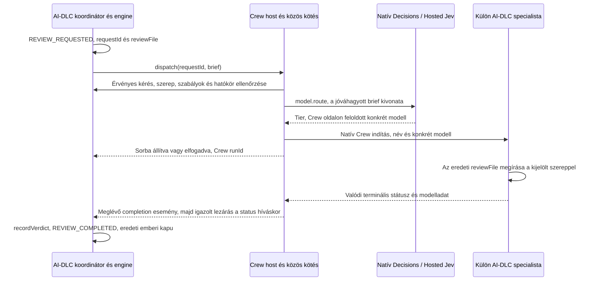

# Közös AI-DLC specialistakiosztás natív Crew Decisions használatával

**2026-11-22 · Tulajdonosi elfogadásra javasolt architektúra.** Az első célpont egy valódi, külön indított AI-DLC tervreviewer. Az Advisor saját App Spawn SDK-hívása forrásreferencia. A [megvalósítási terv](NATIVE_DECISIONS_IMPLEMENTATION_PLAN.md) tartalmazza az érintett függvényeket, a pilotot és az átvételhez szükséges bizonyítékot.

## Ajánlott megoldás

Az AI-DLC kész briefje és a külön specialista indítása közé **egy közös, szűk Crew-kötést** teszünk. Az első hívóhely a Kiro reviewer-kötés a `stage-protocol-reviewer.md` fájlban, az eredeti `REVIEW_REQUESTED` után. Egy, az `aidlc` koordinátor számára engedélyezett managed MCP-eszköz viszi át a kérést a Crew hostba. A host az eredeti `spawn_run` indítási útját, vagyis a gateway `api_spawn` ellenőrzéseit, sorát és workerkezelőjét használja. Az opcionális, szűkített AI-DLC ágon a host **közvetlenül hívja a telepített `model_route.routed_spawn_model()` függvényt**, és a visszakapott konkrét modellt adja át a név szerinti worker indításához.

A Crew fogadja és futtatja a feladatot, a Hosted TypeSafe Jev a natív Decisions-kapun át osztályozza a briefet, az AI-DLC pedig a saját review-kérését és emberi kapuját kezeli. Az illesztés összeköti a valódi Crew-futást az eredeti AI-DLC-kéréssel. Egy indítási és egy eredményolvasási művelet elegendő, új futtató vagy ütemező nélkül.

| Gazda | Felelősség |
| --- | --- |
| AI-DLC engine és Studio | Szerep és skill, sorrend, artefaktum, Q&A, approval, review-manifest, verdict és megjelenítés. A worker nem küld emberi választ és nem zár le szakaszt. |
| Közös kötés | Azonosított koordinátor, AI-DLC kérés és Crew run összekötése. A szerep, a cwd, a capability és a döntés alkalmazhatóságának ellenőrzése. A végrehajtás állapotának visszaadása és a valódi completion kötése a kérelemhez. |
| Crew Decisions | A `model.route` kérdés, tartomány, timeout, mintavétel, consent, tier→modell, opcionális natív árarányos deriválás és döntési napló. Jev szolgáltatása a nehézségi tier besorolását végzi. |
| Crew / KAS worker | Admission, hiteles agent-spec, workspace és sandbox, natív eszközengedélyek, futtatás, completion, modell és használat visszaolvasása. |

## A közös interfész

Két művelet egy eszközön, a tervben `aidlc_delegate` néven. A tool nem fogad szabadon megadott agentet, backendet, cwd-t, output elérési utat vagy szülő session ID-t.

| Művelet | Bemenet és hostoldalon feloldott adatok | Válasz |
| --- | --- | --- |
| `dispatch` | Kérésazonosító és az AI-DLC által összeállított eredeti brief. A host a valódi Crew callerből és az AI-DLC engine aktuális állapotából olvassa a projektet, intentet, szakaszt/attemptet, reviewer szerepet, stage rules-t, forrás-/artefaktumkötést és outputot. | `legacy_allowed` csak ha Crew indítás biztosan nem történt és az eredeti út megengedett. Egyébként a meglevő vagy új `runId` és státusz, vagy kódolt `blocked` / `unknown`. |
| `status` | Ugyanaz a kérésazonosító. A host a tárolt kötésből olvassa a valódi futást és teljesítési bizonyítékot. | `queued`, `approval_required`, `running`, `completed`, `failed`, `cancelled`, `unknown` vagy `stale`. A lezárási nyugta a worker/run és szülő azonosítóját, a kért és észlelt modellt és a review-fájl lenyomatát tartalmazza. Csak igazolt `completed` enged Crew ágon verdiktet rögzíteni. |

A reviewer kulcsa a **projekt + intent + review requestId**. A parent Crew session key és az AI-DLC/KAS session ID két külön érték, amelyeket a host kapcsol össze. A kötés rögzíti az eredeti szerepet, a tényleges sablont és a próbálkozást. Ugyanarra a kérelemre a második hívás a meglévő állapotot adja. A jövőbeli, külön indított nem review szerep ugyanazt az eszközt kapja a saját engine által igazolható szakasz-, attempt- és munkatétel-azonosítójával. Az AI-DLC adja a munkatételhez tartozó kimeneti szerződést.

## Mi alapján választ a natív Decisions?

- A telepített Crew 0.13.0 `subagent_parts/model_choice.py::_route_unpinned_start` függvénye név szerinti agent, crew, explicit backend/modell vagy folytatott conversation esetén kiszáll. Az általános `spawn_run(agent=...)` út így önmagában nem osztályoz AI-DLC workert. A közös kötés szándékosan a belső `routed_spawn_model()` belépést használja, az eredeti guard globális lazítása nélkül. Ez **verzióhoz kötött belső API**.
- A hitelesített szülősessionből olvassuk a KAS provider élő katalógusát és baseline-ját a `provider_advertised_ids`, `inherited_baseline` és `rate_lookup` függvényekkel. Az első pilotban ugyanaz a Kiro fiók, backend és modellnévtér szükséges a workerhez. A hirdetett halmazt az owner által az adott szerephez engedett, megfelelő kontextusablakú konkrét modellekre szűkítjük. Az üres katalógus visszaállást jelent akkor is, ha az upstream resolver hideg lista mellett elfogadna egy pint. A natív kisebb ablakra vonatkozó guard önmagában nem méri a teljes workerpromptot.
- A pilotra a tulajdonos a natív tier térképen rögzíthet két eltérő, ellenőrzött modellt és üres öröklési mezőt. `model_route_derive=true` szükséges magához a worker belépéshez is. A Crew a pin nélküli tiert a hirdetett, engedett árarányokból tölti, vagy öröklést ad. Az üres döntés nem kényszerít modellt. A modell ID-t kanonikus, ugyanazon fiók által hirdetett alakban ellenőrizzük a döntés után és a tényleges indítás előtt.
- Az explicit user modell és effort érintetlen elsőbbségi beállítás. A pilot a kézi pint és a reviewer által örökölt kötelező effortot a Jev előtt ellenőrzi. Ha az eredeti út bizonyítottan megőrzi a kért párt, azt használja. Ha a natív út nem tudja alkalmazni egy explicit worker kérés értékét, a pilot ezt jelzi és megáll. A későbbi automatikus effortválasztás kiindulópontja ez a képességellenőrzés.
- Az owner a Crew **Settings → Developer → Feature Previews** felületén engedélyezi a Hosted TypeSafe Jev endpointot és a `tool_args` scope-ot. A kulcs a Crew vaultból érkezik. A kötés ehhez nem nyúl. A döntési bemenet a feladat célját, szerepét és határait leíró, a briefből kijelölt rövid rész. A worker teljes briefje külön marad. A natív pont legfeljebb 2000 karaktert küld a feladatból, előzményforrás nélkül, saját redakcióval, költség- és időkorláttal a pilotban. Consent, scope, modell, fiók vagy beállítás változása esetén a még el nem indított döntés érvénytelen.
- Hiányzó scope, key, timeout, rossz tier, nem elérhető modell vagy üres feloldás esetén az eredeti út csak **bizonyítottan indítás előtti** állapotból járható. A futó vagy bizonytalan Crew-indítás állapotot és szükség esetén tulajdonosi feloldást igényel. A döntés megismétlése nem megoldás az elveszett launch-válaszra.

Források a natív működéshez. [Crew Decisions 0.13.0](https://github.com/kirodotdev/KiroCrew/blob/v0.13.0/src/kiro_crew/docs/decisions.md) · [routed_spawn_model](https://github.com/kirodotdev/KiroCrew/blob/v0.13.0/src/kiro_crew/decisions/points/model_route.py) · [Név szerinti indítás szűrése](https://github.com/kirodotdev/KiroCrew/blob/v0.13.0/src/kiro_crew/subagent_parts/model_choice.py)

## KAS, Crew és a hívóhelyek

| Út | Döntés és teljes munkaköltség |
| --- | --- |
| Natív KAS `subagent` | A meglévő AI-DLC indítás, hookok és eredménykezelés itt igényelné a legkevesebb munkát, ha volna hívásonkénti konkrét modellátadás. A telepített Kiro CLI 2.37.0 / KAS 0.66.70 név szerinti `subagent_<név>` wrapperében ilyen mező nincs. Az `invoke_sub_agent` feltételes `modelCategory` mezője KAS-kategóriát fogad. A motor a regisztrált profil modelljét tudja használni, a Crew KAS-projekciója ezt a mezőt külön kihagyja. A permission-válasz engedélyez vagy tilt. A saját profilváltozatok és a szülő modelljének átmeneti állítása szerep-, versenyhelyzet- és jogosultsági problémát hozna. A natív út adja a dokumentált visszaállást. Egy támogatott per-child model override kevesebb eredményillesztést igényelhetne. |
| **Crew `spawn_run` futási út, szűk közös kötéssel** | **Ajánlott.** Konkrét modellel és név szerinti agenttel létező út. Megtartja a Crew kapacitáskezelését, az eredeti parenthez kötött completiont és a státuszadatot. Az új munka a szűk grant, a pontos szerepprofil és a request/run/artefaktum lezárás illesztése. Ezeket egyszer építjük meg. |
| `spawn_sub_agents`, session/work-dispatch, Dynamic Workflows, App Spawn SDK | A blocking tool telepített sémájából hiányzik ez a konkrét modellparaméter. A session/work-dispatch és a Dynamic Workflows saját végrehajtási állapotot kérne az AI-DLC mellé. Az App Spawn SDK az app saját agentjeit indítja, eltérő parent- és jogosultsági úton. Studio Advisor, illetve a parent chat `Auto (decision model)` beállítása más döntési helyet fed le. |

A Kiro újabb `updatedInput` dokumentációja a választott tool sémáján belüli módosítást írja le. A pilot a telepített verziók viselkedésén alapul. A korábbi négy valódi CrewLab natív specialistaindítás `modelId=auto`, `modelOverride=false`, `effortOverride=false` értéket mutatott. A kiszolgáló konkrét modelljét és az egyedi worker fogyasztását ebből nem ismerjük. [Kiro hook](https://kiro.dev/docs/hooks/types/#pre-tool-use) · [KAS-projekció](https://github.com/kirodotdev/KiroCrew/blob/v0.13.0/src/kiro_crew/acp/kas_agents.py) · [CrewLab audit](CREWLAB_TRIAL_REPORT.md)

**Első körben egy protokoll-kötés, egy megosztott transport/host út és egy review-lezárási pont.** A natív review-kiosztás meglévő PreToolUse útján külön kizárási ellenőrzés szükséges ugyanarra a kérelemre. A Crew MCP-hívás nem egy központi AI-DLC TypeScript `dispatch()` helyettesítése. Jelenleg a protokollok a koordinátornak adják az indítási utasítást.

| AI-DLC hívóhely | Közös kötés alkalmazása |
| --- | --- |
| `stage-protocol-reviewer.md` | Első binding az önálló tervreview-hoz. A javítási kör és az új review-iteráció is innen veheti át az eljárást, az új kérelem saját azonosítójával. |
| `stage-protocol-ensemble.md` / `stage-protocol.md` | Egy további kötés a lead és supporter, a soros pipeline és a párhuzamos mob számára. Az esetleges közvetlen `stage-protocol.md` indítás ugyanarra az ensemble kötésre hivatkozik. A linknyugtát és a sorrendet az AI-DLC továbbra is maga kezeli. Külön specialisták a saját briefjükkel párhuzamosan futhatnak. |
| `stage-protocol-wave.md` és `stage-protocol-reviewer-unit.md` | Egy wave-kötés és egy reviewer-unit előfeltétel: az utóbbi a közös reviewer-kötést használja, a `dispatchAgent` és a szűkebb Unit olvasási jog bizonyításával. A wave külön munkatételt és outputot ad. |
| `stage-protocol-swarm.md` | Külön fan-out kötés a már jóváhagyott worktree-kre. Eltérő cwd, approvals, Unit check/review/finalize bizonyíték. Egyedi jogosultság vagy cwd mellett egyenkénti Crew indítás ugyanazzal az eljárással. |
| Inline stage, inline build/test | Marad inline. Külön quality vagy tesztelő specialistát a saját meglévő delegáló protokollja vihet át. |

Így a mai forrásból a bővítéshez **négy ütemezett protokoll-kötéssel** számolunk (reviewer, ensemble, wave és swarm), a `stage-protocol.md` hivatkozásával és a `reviewer-unit` scope-illesztésével. A közvetlen kiosztásokat az adott szakasz migrálásakor át kell vezetni. Négy ilyen stage-fájlt kell áttekinteni a telepített payloadban: `reverse-engineering.md` (scan/developer/architect), `practices-discovery.md` (első lead és integrálás), `code-generation.md` (Part 2 developer), `deployment-execution.md` (operation, csak külön engedéllyel). A `user-stories.md` már a közös stage-protokollra hivatkozik, a `reviewer-repair` a stage futtatási módjához tér vissza. A nyelvi utasítás mellett a host minden támogatott kiosztást ellenőriz. [Meglévő belépési pontok](research/AI_DLC_CREW_ROUTING_INTEGRATION_2026-11-22.md#belépési-pontok-az-ai-dlc-ben)

## Megőrzés, bővítés és visszaállítás

A Crew 0.13.0, Studio 2.0.1 (`8b3881d4737399c3394d8d187f102a5c95d6e528`), AI-DLC 2.11.3 és a Studio négy kompatibilitási javítása a viszonyítási alap. A pilotban újrafelhasználjuk a specialisták forrásprofilját, a stage-rules/plan-approval guardot, az eredeti audit, review-log és kapu feldolgozását, a Crew worker kezelését és a natív Decisions szolgáltatót. Verziózott változtatás csak a caller bindingra, az engedélyre, a hostoldali kötésre és a requesthez kötött review-bizonyíték ellenőrzésére szükséges. A tényleges fájlok és függvények a [megvalósítási tervben](NATIVE_DECISIONS_IMPLEMENTATION_PLAN.md#érintett-fájlok).

A legnagyobb kockázatok a külön KAS sessionben elvesző eszközkorlátok, a hamis vagy késve érkező completion, és a két úton elinduló azonos feladat. Az átvételhez mindháromra kell tiltási vagy helyreállítási bizonyíték. Amíg ez nincs meg, a routing kikapcsolva marad. A fallback az eredeti natív futtatás. Kikapcsoláskor a már elfogadott Crew-futás a saját nyugtájával fut ki vagy leáll, majd a következő kérelem a natív útra kerül.

Később a kötés a `backend/model/effort` paramétereket és ugyanazt a completiont tudja továbbadni. Másik backendnél saját katalógust és igazolt profilegyenértékűséget kell adni. Kötelező effort esetén a modellválasztás előtti képességszűrés a megfelelő hely. A natív run és session azonosítókhoz mérhető Kiro-kreditet vagy Codex-tokeneket lehet majd kötni. A kvóta, költség és modellek közötti automatikus választás külön bővítés.

A korábbi upstream ellenőrzés 2026-11-22-i pillanatképe szerint a [#19376](https://github.com/kirodotdev/KiroCrew/pull/19376) beolvadt. A [#23733](https://github.com/kirodotdev/KiroCrew/pull/23733) draft, a [#23732](https://github.com/kirodotdev/KiroCrew/issues/23732) és [#25812](https://github.com/kirodotdev/KiroCrew/issues/25812) nyitott, a [#35488](https://github.com/kirodotdev/KiroCrew/pull/35488) tervezési RFC, a [#17132](https://github.com/kirodotdev/KiroCrew/pull/17132) nyitott PR volt. A [#38556](https://github.com/kirodotdev/KiroCrew/pull/38556) beolvadt, a helyi 0.13.0 még nem ismeri a `usage` alparancsot. A terv ezekből a későbbi felületekből egyet sem igényel.
