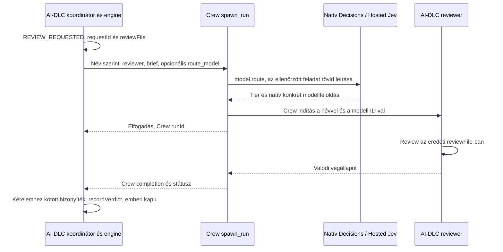

# Közös AI-DLC specialistakiosztás natív Crew Decisions használatával

**2026-11-22 · Tulajdonosi elfogadásra javasolt architektúra.** Az első célpont egy valódi, külön indított AI-DLC tervreviewer. Az Advisor saját App Spawn SDK-hívása forrásreferencia. A [megvalósítási terv](NATIVE_DECISIONS_IMPLEMENTATION_PLAN.md) tartalmazza az érintett függvényeket, a pilotot és az átvételhez szükséges bizonyítékot.

## Ajánlott megoldás

**A telepített Crew 0.13.0-ban a teljes lánchoz nem találtunk támogatott patch nélküli utat.** A `spawn_run` el tudja indítani a név szerinti AI-DLC specialistát, át tud venni konkrét modellt, és visszaadja a futásazonosítót a szülőnek. A hiányzó interfész az, amelyik ugyanebben a hívásban a név szerinti, modellben nem rögzített specialista briefjét a natív `model.route` ponthoz küldi, és a választ alkalmazza.

Tartsuk meg a **meglévő `spawn_run` eszközt**. A kézzel megadott modell már most alkalmas annak vizsgálatára, hogy a reviewer jogosultsága és eredménye átvihető-e az eredeti AI-DLC review-kéréshez. Ennek igazolása után az első javasolt Crew-módosítás egy **alapból kikapcsolt, hívásonkénti opció**, például `route_model: true`. A gateway az ellenőrzött, név szerint kiválasztott agentprofil esetén egyszer meghívja az eredeti `routed_spawn_model()` függvényt, majd az eredményt a már létező `model=` mezőn adja át. A sikeres indítás a meglévő admission, queue, worker és completion úton halad. A korábbi `aidlc_delegate` MCP-eszköz és külön Crew státuszvégpont kikerül az alapjavaslatból.

## A hiányzó interfész a forrásban

- A `spawn_parts/schemas.py` és a tényleges validálást végző `SPAWN_RUN_SCHEMA` modell ID-t, agentnevet és effortot fogad. A `spawn.py::spawn_run` ezeket átadja a `POST /api/spawn` hívásnak, a `dashboard/messaging_api/spawn.py::api_spawn` pedig továbbadja a `model=` értéket az indítónak. A `model: "auto"` öröklési vagy backendválasztási érték, és az `info.model` guard miatt ezen az úton a Jevhez sem jut el. [MCP séma](https://github.com/kirodotdev/KiroCrew/blob/v0.13.0/src/kiro_crew/mcp_tools/spawn_parts/schemas.py#L271) · [Spawn gateway](https://github.com/kirodotdev/KiroCrew/blob/v0.13.0/src/kiro_crew/dashboard/messaging_api/spawn.py#L858)
- A `model_choice.py::_route_unpinned_start` már az `info.agent` jelenlétében visszatér. Név nélküli indításnál örökölt vagy alap template fut, így a név elhagyása nem őrzi meg az önálló reviewer szerepét és jogait. A natív `routed_spawn_model()` viszont már megoldja a `tool_args` consentet, a nehézségi besorolást, a tier modellre feloldását és az üres vagy nem alkalmazható döntés kezelését. A `model_route_derive` önmagában nem oldja fel a név szerinti guardot. [A guard](https://github.com/kirodotdev/KiroCrew/blob/v0.13.0/src/kiro_crew/subagent_parts/model_choice.py#L83) · [A natív döntéshívás](https://github.com/kirodotdev/KiroCrew/blob/v0.13.0/src/kiro_crew/decisions/points/model_route.py#L996)
- A Decisions REST útjai beállítást, consentet, állapotot és visszajelzést kezelnek. A SageMaker-próba egy kötött tesztkérdés. Nincs olyan támogatott MCP, REST vagy App SDK művelet, amelyik a valódi szülősession és worker modellkatalógusa alatt egy tetszőleges specialistabriefre futtatható modell ID-t ad. A Crew forrása technikailag importálható egy megbízható host appból, de a natív caller, provider, admission és státusz belső határait ekkor az adapternek kellene összekötnie. Az App Spawn SDK és az app-tokenes REST indítás saját apphoz kötött agentet, illetve szülőt enged. A managed `strictSession` app tool deklaráció a csomagolt első fél eszközeinek felülete. A Studio manifestjébe írt új deklaráció önmagában nem kapja meg ezt a kötést. [Decisions route-ok](https://github.com/kirodotdev/KiroCrew/blob/v0.13.0/src/kiro_crew/dashboard/routes/system.py#L240) · [App határ az indításnál](https://github.com/kirodotdev/KiroCrew/blob/v0.13.0/src/kiro_crew/dashboard/messaging_api/spawn.py#L509) · [Managed app tool](https://github.com/kirodotdev/KiroCrew/blob/v0.13.0/src/kiro_crew/apps/app_agent_tools.py#L109)

## Felelősség és visszatérés

| Gazda | Felelősség |
| --- | --- |
| AI-DLC engine és Studio | A brief, szerep, stage rules, jogosultság, review-kérés, fájl, `recordVerdict` és az emberi kapu. Egy közös protokoll köti a kérés azonosítóját a Crew-futáshoz. |
| Crew `spawn_run` és Decisions | Hiteles szülő, modell- és backendellenőrzés, natív `model.route`, admission, indítás és futási állapot. A válasz csak a queue elfogadását vagy az indítást igazolja. |
| AI-DLC eredményillesztés | Az eredeti `requestId` és a valódi Crew `runId` egyezése, terminális siker, reviewerazonosság és az eredeti `reviewFile` lenyomata. Újranyitáskor az ismert futáshoz tér vissza. |

A `spawn_run` completion eseménye felébresztheti a dashboardos koordinátort. A `spawn_status` és a gateway futásrekordja igazolhatja a terminális futást. Ezek önmagukban nem állítják elő az AI-DLC `SubagentStop` nyugtáját, és a szöveges MCP-válasz nem köti a futást a megfelelő review-kéréshez. Az AI-DLC oldalon előbb a meglévő, hiteles Crew-adatokból kell bizonyítani az azonosítók, a tényleges modell és a változatlan review-fájl kapcsolatát. A meglévő státusz felület csak akkor bővítendő, ha az engine egy kötelező lezárási adatot másként nem tud hitelesen átvenni. [Crew terminális esemény](https://github.com/kirodotdev/KiroCrew/blob/v0.13.0/src/kiro_crew/subagent_manager/terminal.py#L459) · [Külön KAS review és AI-DLC audit](CREWLAB_TRIAL_REPORT.md)

Az opt-in csak ellenőrzött szülősessionre és engedett szerepre fusson. A kézi modell és effort, a szerephez vagy sessionhöz tartozó kötelező pin, valamint a Crew saját jogosultságai élveznek elsőbbséget. A provider élő katalógusából és a szerephez engedett, megfelelő kontextusablakú modellekből dolgozzon a natív resolver. A Jev a `tool_args` consent alatt csak feladatleírást kaphat. Opt-in nélkül a teljes Crew alapviselkedés érvényes. Aktív opt-in mellett egy konkrét modell hiánya az AI-DLC natív KAS ágára csak igazoltan **indítás előtti** eredménnyel enged vissza. Elfogadott vagy bizonytalan indításnál az ismert futás állapotát kell feloldani.

## KAS, Crew és a hívóhelyek

| Út | Döntés és teljes munkaköltség |
| --- | --- |
| Natív KAS `subagent` | A meglévő AI-DLC indítás, hookok és eredménykezelés itt igényelné a legkevesebb munkát, ha volna hívásonkénti konkrét modellátadás. A telepített Kiro CLI 2.37.0 / KAS 0.66.70 név szerinti `subagent_<név>` wrapperében ilyen mező nincs. Az `invoke_sub_agent` feltételes `modelCategory` mezője KAS-kategóriát fogad. A motor a regisztrált profil modelljét tudja használni, a Crew KAS-projekciója ezt a mezőt külön kihagyja. A permission-válasz engedélyez vagy tilt. A saját profilváltozatok és a szülő modelljének átmeneti állítása szerep-, versenyhelyzet- és jogosultsági problémát hozna. A natív út adja a dokumentált visszaállást. Egy támogatott per-child model override kevesebb eredményillesztést igényelhetne. |
| Crew `spawn_run(agent=…, model=…)` | Patch nélküli futtatási és eredményátadási próba kézi modellel. Így külön mérhető a szerep, a jogosultság és az eredeti review-kérés lezárása. |
| **Crew `spawn_run`, hívásonkénti Decisions opt-innel** | **Ajánlott az automatizáláshoz.** A natív indítás, státusz és completion mellett megnyitja a meglévő modellválasztást a jóváhagyott, név szerinti template előtt. |
| `spawn_sub_agents`, session/work-dispatch, Dynamic Workflows, App Spawn SDK | A blocking tool telepített sémájából hiányzik ez a konkrét modellparaméter. A session/work-dispatch és a Dynamic Workflows saját végrehajtási állapotot kérne az AI-DLC mellé. Az App Spawn SDK az app saját agentjeit indítja, eltérő parent- és jogosultsági úton. Studio Advisor, illetve a parent chat `Auto (decision model)` beállítása más döntési helyet fed le. |

A Kiro újabb `updatedInput` dokumentációja a választott tool sémáján belüli módosítást írja le. A pilot a telepített verziók viselkedésén alapul. A korábbi négy valódi CrewLab natív specialistaindítás `modelId=auto`, `modelOverride=false`, `effortOverride=false` értéket mutatott. A kiszolgáló konkrét modelljét és az egyedi worker fogyasztását ebből nem ismerjük. [Kiro hook](https://kiro.dev/docs/hooks/types/#pre-tool-use) · [KAS-projekció](https://github.com/kirodotdev/KiroCrew/blob/v0.13.0/src/kiro_crew/acp/kas_agents.py) · [CrewLab audit](CREWLAB_TRIAL_REPORT.md)

**Első körben egy protokoll-kötés a meglévő Crew eszközökhöz és egy review-lezárási pont.** A natív review-kiosztás meglévő PreToolUse útján külön kizárási ellenőrzés szükséges ugyanarra a kérelemre. A Crew MCP-hívás nem egy központi AI-DLC TypeScript `dispatch()` helyettesítése. Jelenleg a protokollok a koordinátornak adják az indítási utasítást.

| AI-DLC hívóhely | Közös kötés alkalmazása |
| --- | --- |
| `stage-protocol-reviewer.md` | Első binding az önálló tervreview-hoz. A javítási kör és az új review-iteráció is innen veheti át az eljárást, az új kérelem saját azonosítójával. |
| `stage-protocol-ensemble.md` / `stage-protocol.md` | Egy további kötés a lead és supporter, a soros pipeline és a párhuzamos mob számára. Az esetleges közvetlen `stage-protocol.md` indítás ugyanarra az ensemble kötésre hivatkozik. A linknyugtát és a sorrendet az AI-DLC továbbra is maga kezeli. Külön specialisták a saját briefjükkel párhuzamosan futhatnak. |
| `stage-protocol-wave.md` és `stage-protocol-reviewer-unit.md` | Egy wave-kötés és egy reviewer-unit előfeltétel: az utóbbi a közös reviewer-kötést használja, a `dispatchAgent` és a szűkebb Unit olvasási jog bizonyításával. A wave külön munkatételt és outputot ad. |
| `stage-protocol-swarm.md` | Külön fan-out kötés a már jóváhagyott worktree-kre. Eltérő cwd, approvals, Unit check/review/finalize bizonyíték. Egyedi jogosultság vagy cwd mellett egyenkénti Crew indítás ugyanazzal az eljárással. |
| Inline stage, inline build/test | Marad inline. Külön quality vagy tesztelő specialistát a saját meglévő delegáló protokollja vihet át. |

Így a mai forrásból a bővítéshez **négy ütemezett protokoll-kötéssel** számolunk (reviewer, ensemble, wave és swarm), a `stage-protocol.md` hivatkozásával és a `reviewer-unit` scope-illesztésével. A közvetlen kiosztásokat az adott szakasz migrálásakor át kell vezetni. Négy ilyen stage-fájlt kell áttekinteni a telepített payloadban: `reverse-engineering.md` (scan/developer/architect), `practices-discovery.md` (első lead és integrálás), `code-generation.md` (Part 2 developer), `deployment-execution.md` (operation, csak külön engedéllyel). A `user-stories.md` már a közös stage-protokollra hivatkozik, a `reviewer-repair` a stage futtatási módjához tér vissza. Minden bekötött kiosztásnál az eredeti AI-DLC guardok és a Crew indítási ellenőrzései érvényesek. [Meglévő belépési pontok](research/AI_DLC_CREW_ROUTING_INTEGRATION_2026-11-22.md#belépési-pontok-az-ai-dlc-ben)

## Megőrzés, bővítés és visszaállítás

A Crew 0.13.0, Studio 2.0.1 (`8b3881d4737399c3394d8d187f102a5c95d6e528`), AI-DLC 2.11.3 és a Studio négy kompatibilitási javítása a viszonyítási alap. A pilotban újrafelhasználjuk a specialisták forrásprofilját, a stage-rules/plan-approval guardot, az eredeti audit, review-log és kapu feldolgozását, a Crew worker kezelését és a natív Decisions szolgáltatót. A tervezett Crew diff a `spawn_run` opt-inre és annak gateway-ellenőrzésére szorítkozik. Az AI-DLC payload adja a protokollt és a review-kéréshez kötött lezárást. A státusz vagy bizonyíték olvasásának esetleges külön módosításáról az első próba forrás- és futási eredménye alapján döntsünk. A tényleges fájlok és függvények a [megvalósítási tervben](NATIVE_DECISIONS_IMPLEMENTATION_PLAN.md#érintett-fájlok).

A legnagyobb kockázatok a külön KAS sessionben elvesző eszközkorlátok, a hamis vagy késve érkező completion, és a két úton elinduló azonos feladat. Az átvételhez mindháromra kell tiltási vagy helyreállítási bizonyíték. Amíg ez nincs meg, a routing kikapcsolva marad. A fallback az eredeti natív futtatás. Kikapcsoláskor a már elfogadott Crew-futás a saját nyugtájával fut ki vagy leáll, majd a következő kérelem a natív útra kerül.

Később a kötés a `backend/model/effort` paramétereket és ugyanazt a completiont tudja továbbadni. Másik backendnél saját katalógust és igazolt profilegyenértékűséget kell adni. Kötelező effort esetén a modellválasztás előtti képességszűrés a megfelelő hely. A natív run és session azonosítókhoz mérhető Kiro-kreditet vagy Codex-tokeneket lehet majd kötni. A kvóta, költség és modellek közötti automatikus választás külön bővítés.

A korábbi upstream ellenőrzés 2026-11-22-i pillanatképe szerint a [#19376](https://github.com/kirodotdev/KiroCrew/pull/19376) beolvadt. A [#23733](https://github.com/kirodotdev/KiroCrew/pull/23733) draft, a [#23732](https://github.com/kirodotdev/KiroCrew/issues/23732) és [#25812](https://github.com/kirodotdev/KiroCrew/issues/25812) nyitott, a [#35488](https://github.com/kirodotdev/KiroCrew/pull/35488) tervezési RFC, a [#17132](https://github.com/kirodotdev/KiroCrew/pull/17132) nyitott PR volt. A [#38556](https://github.com/kirodotdev/KiroCrew/pull/38556) beolvadt, a helyi 0.13.0 még nem ismeri a `usage` alparancsot. A terv ezekből a későbbi felületekből egyet sem igényel.
