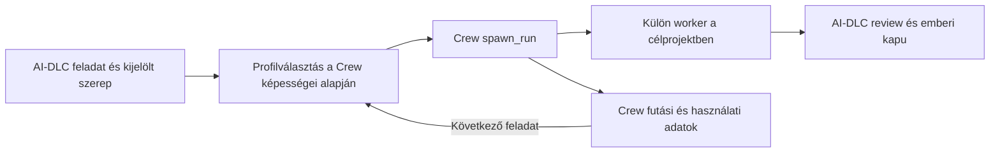

# AI-DLC és Kiro Crew modellválasztási architektúra

**2026. november 22. · Javaslat tulajdonosi review-ra**

Az AI-DLC Studio adja a munkafolyamatot, a feladatokat, a specialisták szerepét és az emberi jóváhagyást. A Kiro Crew indítja a workert és adja a futási adatokat. Először egy meglévő AI-DLC tervreview-n ellenőrizzük, hogy ez a két rész konfigurációval összeilleszthető-e. Az első próba időkerete **fél munkanap**. A feladatonkénti modell- és effortválasztáshoz csak ott adjunk saját kódot, ahol a próba konkrét hiányt mutat.

A cél az **elfogadott feladat teljes erőforrásigényének csökkentése**. Az első választás már a feladat nehézségére és kockázatára reagál, akkor is, ha mindkét szolgáltatónál bőséges a keret. A felhasznált erőforrás visszajelzés a következő döntésekhez. A megmaradt keret külön korlát. [Munkaterv](../WORK_PLAN.md) · [KovacsTrader workflow](history/KOVACS_WORKFLOW.md)

## Meglévő elemek és felelősségek

| Elem | Amit újrahasználunk | Amit a próbán igazolni kell |
| --- | --- | --- |
| **AI-DLC Studio 2.0.1** | A meglévő szakaszok, feladatbontás, szerepek, skillek, projektartefaktumok, review-kérés és emberi kapu. A review-kérés a vizsgált artefaktumhoz kötődik. | Az eredeti kérés alatt fogadja el és mutatja meg a külön Crew-worker jelentését. |
| **Kiro Crew 0.13.0** | `spawn_run`, futásazonosító és állapot, felajánlott modellek, effort és kontextusöröklés. A Crew ellenőrzi az indítás jogosultságait. | A Studio koordinátora eléri az indítóeszközt. A név szerint indított worker a megfelelő projektben, szereppel, eszközökkel és tényleges beállításokkal fut. |
| **Crew használati adatok** | A futásokhoz tartozó kredit-, token-, idő- és kontextusadatok, ahol a backend szolgáltatja őket. A fiókkeret külön nézetből olvasható. | Az eredeti AI-DLC kérés, a Crew futás és a használati adatsor összerendelhető a jóváhagyott olvasási felületen. |
| **Helyi konfiguráció vagy kis illesztő** | A tervező meglévő feladatleírásából képzett rövid átadás, néhány ellenőrzött Crew-profil és a választás indoka. | Ugyanarra a szerepre eltérő nehézségű munkánál azonos keret mellett is eltérő, támogatott beállítás adható. |

A CrewLab futása igazolta a Studio szakaszait, a tényleges emberi jóváhagyásokat és az elkülönült natív Kiro-review-t. A natív Kiro-alügynökök egyenkénti fogyasztása és alkalmazott effortja nyitott kérdés. A Crew `spawn_run` explicit beállításokat fogad, de a név szerint vagy explicit backenddel indított workert a Crew automatikus `model_route_derive` útvonala kihagyja. [CrewLab-audit](CREWLAB_TRIAL_REPORT.md) · [Crew subagent dokumentáció](https://github.com/kirodotdev/KiroCrew/blob/v0.13.0/src/kiro_crew/docs/subagents.md) · [Natív indítási döntés](https://github.com/kirodotdev/KiroCrew/blob/v0.13.0/src/kiro_crew/subagent_parts/model_choice.py#L83)

## A kiosztás útja

**Átadás.** A már létező AI-DLC szakasz adja a kijelölt szerepet, a releváns inputokat és a kimeneti szerződést. A koordinátor átadja a projektet és a vizsgált revíziót vagy artefaktumlenyomatot, a pontos feladatot, a szerephez tartozó útmutatót, a releváns fájlutakat, az elfogadási feltételeket és a szükséges eszközöket. Ugyanaz a szerep több ellenőrzött futtatási profillal is összerendelhető. A Crew kontextusöröklése tartsa meg a projektszabályokat és a jóváhagyott döntéseket. A reviewer az artefaktumot és az elvárásokat kapja meg, a szerző teljes chatje helyett. [A Studio rögzített kiadása](https://github.com/warren830/kirocrew-app-aidlc/tree/8b3881d4737399c3394d8d187f102a5c95d6e528) · [Kontextus a munkatervben](../WORK_PLAN.md#4-smart-context-handling-is-part-of-the-core)

**Profilválasztás.** Előbb szűrjük a jelölteket szerep, jogosultság, szükséges eszközök, modelltámogatás, kontextusméret, effort és a feladat megkövetelt minősége alapján. A tulajdonos rögzített modell- vagy effortbeállítása szűkíti a jelölteket. Ezen belül egy egyértelmű, teszttel lezárható módosításhoz elegendő lehet egy gazdaságos profil. Egy több komponensre kiterjedő hibafeltáráshoz rögtön indokolt lehet erősebb modell vagy nagyobb effort. A profilok ellenőrzött alapértékeit később a hasonló, elfogadott futások tényleges fogyasztása, ideje és javítási igénye pontosítja. Szűk fiókkeret kizárhat egy profilt. A hiányzó vagy elavult keretadat `unknown` marad. A választás indoka és a ténylegesen alkalmazott profil legyen visszakereshető. Ha nincs megfelelő profil, a kiosztás vár és megnevezi a hiányzó feltételt.

**Indítás és eredmény.** A Crew `spawn_run` hívása indít a kiválasztott `agent`, `backend`, `model` és `reasoning_effort` értékekkel. A koordinátor elkülönítve rögzíti a kért és a futás által visszaigazolt értékeket. Review esetén a Studio meglévő `requestId`, `reviewFile` és artefaktumlenyomat kötése marad érvényes. A koordinátor a valódi, külön worker eredményét az eredeti kéréshez vezeti vissza a Studio normál protokollján. A Crew befejezési eseménye futási bizonyíték. Az emberi döntést a Studio a saját kapuján rögzíti. Újraindításnál először a korábbi `requestId` és `run_id` állapotát kell visszaolvasni, hogy a függő review ne induljon el még egyszer.

**A kritikus illesztés.** A CrewLab `aidlc` profilja jelenleg a Kiro natív `subagent` eszközét deklarálja. A mappából betöltött agent konfigurációjának egy részét KAS szűri, így a natív Crew eszköz elérhetőségét ugyanabban a Studio-munkamenetben kell ellenőrizni. Ellenőrizni kell a worker tényleges projektkönyvtárát és a reviewer engedélyezett kimeneti útvonalát is. A Studio Advisor alkalmazásszintű `spawn.run` felülete modellfelülbírálást tud, de külön backendhez és efforthoz nincs paramétere. Emiatt a koordinátorból elérhető, engedélyezett `spawn_run` a vizsgálandó út. [KAS agent betöltés](https://github.com/kirodotdev/KiroCrew/blob/v0.13.0/src/kiro_crew/acp/harness/kas.py#L352) · [Crew App Spawn API](https://github.com/kirodotdev/KiroCrew/blob/v0.13.0/src/kiro_crew/apps/spawn_sdk.py#L165)

Ha a próba után saját illesztő kell, a javasolt helye az `integrations/aidlc-crew/`. Ide kerülhet egy Crew-skill, amely a meglévő review-kérés alapján használja az indítási utat, és egy profiltábla, amely az AI-DLC szerepet a Crew-ban igazolt futtatási beállításokhoz rendeli. A választófüggvény és az olvasó csak akkor kerül melléjük, ha a konfiguráció ezeket nem tudja következetesen elvégezni. A projekt gyökere, szabályai és a megengedett eszközök mindig a kiválasztott célprojektből származnak. A közös skill betöltéséhez a Crew már támogat külön skill könyvtárat. [Crew skill betöltés](https://github.com/kirodotdev/KiroCrew/blob/v0.13.0/src/kiro_crew/docs/skills.md)

## Fogyasztás és visszacsatolás

Az első futástól a Crew saját futási rekordjai és a Studio eredeti kérésazonosítója szolgálnak forrásként. A kapcsolathoz elegendő az issue vagy intent, szakasz, feladat vagy review-kérés, parent és worker futásazonosító, vizsgált revízió, választás indoka, kért és látható beállítások, eredmény és fogyasztás. Elsőként a Crew meglévő felületein ellenőrizzük az adatokat. Ha a koordinátor nem tudja ugyanazt az összesítést támogatott módon megkapni, egy szűk, csak olvasható összesítő a következő kiegészítés. Az app hívó számára a `/api/usage/turns` saját alkalmazáshoz tartozó sorokra szűr, ezért az operátori nézet elérhetősége önmagában nem igazolja a koordinátori hozzáférést. [Crew futásonkénti használat](https://github.com/kirodotdev/KiroCrew/blob/v0.13.0/src/kiro_crew/dashboard/handlers/telemetry.py#L1646) · [Kiro keret és Codex limitablakok](https://github.com/kirodotdev/KiroCrew/blob/v0.13.0/src/kiro_crew/dashboard/handlers/usage.py#L705)

A teljes eredményhez számít a koordinátor, a sikeres és sikertelen worker, az ellenőrzés és az ismétlés fogyasztása. A natív Kiro-alügynök a szülő mérésében szerepelhet, ezért csak a külön tulajdonított tételeket adjuk hozzá. A riport külön kezeli a Kiro-kreditet, a Codex input-, output- és cache-tokenjeit, a kontextusfoglalást, a fiókkeretet és az eltelt időt. A mértékegység, a forrás, az időpont és a hiányzó adatok a döntéshez is kellenek. Az egyik szolgáltatónál megtakarított kredit a másik szolgáltató több tokenjével együtt mutatható be, közös árfolyam feltételezése nélkül. [Korábbi mérési megfigyelések](history/RESEARCH_COST_NOTES.md)

## Megközelítések és karbantartás

| Megközelítés | Mi a munka? | Mikor éri meg? |
| --- | --- | --- |
| **Crew és Studio konfiguráció** | Egy meglévő reviewer, elérhető és engedélyezett `spawn_run`, egy ismert profil és kézzel ellenőrzött natív futási adatok. Alacsony ráfordítás, a hozzáférés és a review-visszaadás a bizonytalan része. | Első próba. Ha az AI-DLC instrukciója és a natív Crew-eszköz feladatonként is helyesen alkalmazza a beállítást, elég lehet egy kis konfiguráció és célzott ellenőrzés. |
| **Kis helyi illesztő** | A már meglévő AI-DLC feladatleírás leképezése Crew-profilra egy átadási ponton. Első változatként egy rövid Crew-skill és profiltábla a jelöltek. Ha a próbán következetlen a választás, egy kis determinisztikus függvény indokolt. Közepes integrációs nehézség. | Ha a natív indítás és a review már átmegy, de a feladatonkénti modell- és effortválasztás vagy a usage összekötése még hiányzik. Ez a javasolt továbbépítés. |
| **Külső döntési kód adaptálása** | A thinkdial `route()` leválasztható. Besorolást és profilokat vár, minőségi minimumot és bizonytalanságot kezel. A Crew jogosultságait és használatát ettől még illeszteni kell. A Quartermaster a feladat átadhatóságához ad hasznos szabályt, amelyet a meglévő AI-DLC terven lehet alkalmazni. | Csak akkor vegyünk át konkrét függvényt, ha a meglévő bemenetekkel kevesebb illesztést és karbantartást jelent, mint néhány helyi szabály. Átvételnél rögzítsük a pontos upstream revíziót és őrizzük meg a licencet és a szerzői jelölést. [thinkdial](https://github.com/DmitryBMsk/thinkdial/blob/2701bac3f7ae1324f596e96e02e8f8e1e315cae4/hooks/policy.ts#L405) · [Quartermaster](https://github.com/jacob-mcclelland/quartermaster/blob/b0caebf311e68f8de4d2c6e1bf59c6311b1496cd/jev/plan_router.py#L84) |
| **Kész rangsoroló külön futtatása** | A `gh-aw-router` önálló CLI, de a vizsgált kiadás három költségtáblájában nincs Kiro/KAS profil. Helyi táblákat, érvényes modell-effort párokat és Crew mérésekből kalibrációt igényelne. Ez magasabb ráfordítás és külön frissítési feladat. | Akkor érdemes újra felmérni, ha a sok mért profil közti rangsorolás ténylegesen túlnő az egyszerű szabályokon, vagy megjelenik a kompatibilis kész támogatás. [Router CLI és táblák](https://github.com/github/gh-aw-firewall/tree/v0.29.17/containers/router) |

## Megvalósítási lépések és becslés

| Lépés | Késznek tekinthető, ha | Becsült idő |
| --- | --- | --- |
| **1. Natív próba a CrewLabban** | Először az eszköz, a projekt és a workerprofil elérhetőségét ellenőrizzük. Ha rendben vannak, az AI-DLC a **Kiro Crew: Start** útvonalon egy valódi, forrásra épülő tervet ad át egy független reviewernek. Rögzítjük a review-kérés és futás kapcsolatát, valamint az első használati adatokat. | **0,5 napos időkeret**. Ha a feltételek ezen belül elakadnak, itt álljunk meg a hibaponttal. |
| **2. Választási szabály és rövid kontextus** | A meglévő szerephez két eltérő nehézségű mintafeladat azonos keret mellett két megfelelő modell-effort párost ad. A választás indokolható. A nem támogatott effektív beállítás vagy a hiányzó jogosultság látható, a reviewer szerepe és a szükséges kontextusa megmarad. | **0,5–1 nap**, ha az indítási felület működik. |
| **3. Futáshoz kötött mérés és ellenőrzés** | Az első futás rögzített használati adatai az eredeti review-hoz kapcsolhatók. Új élő futás akkor indokolt, ha a választási szabály vagy az átadás változása külön igazolást igényel. A futási és fiókszintű adatok külön szerepelnek, és a koordinátor a következő választásnál megkapja a releváns összesítést. | **0,5–1 nap**, ha a natív rekordok korrelálhatók. |

A három lépés **1,5–2,5 fókuszált munkanap** sikeres natív illesztés esetén. Ez egy tervreview-ra korlátozott prototípus becslése. A megvalósítói szerep és egy második backend bizonyítása külön mérhető bővítés, becslés szerint további **1–2 nap**, ha ugyanazt az illesztést tudják használni. A teljes, GitHub issue-tól PR-ig tartó rendszerre továbbra is a [munkaterv](../WORK_PLAN.md) mérföldkövei vonatkoznak. A normál indítás a [jelenlegi VS Code-feladaton](../.vscode/tasks.json) keresztül történik.

A korábbi mintaprojekt javítását és bizonyítékait meg kell őrizni. Az élő futás a meglévő próbatervek szerinti ártalmatlan feladaton igazolja a jóváhagyás nélküli továbblépés megtagadását, a forrás érintetlenségét és a függő emberi kapu helyreállítását újraindítás után. Az első kötelező hiba után rögzítjük a várt és tényleges eredményt, majd tulajdonosi egyeztetésig megáll a rá épülő munka. [A korlátozott próba szabályai](NEXT_STEP.md#c-exercise-only-planning-review-and-its-user-gate)

## Megéri-e és mikor váltsunk egyszerűbb megoldásra?

**A fél napos próba megéri.** Egy kis, két fájlt érintő CrewLab-javításnál 34,9157 Kiro-kredit volt a kapcsolt fogyasztás, a végső kontextus 77%-át eszközkimenet tette ki, és a feladat dokumentációs feltétele elmaradt. Ez a futás az integráció lehetséges nyereségét és a minőségi ellenőrzés szükségességét mutatja. A megtakarítást azonos kiinduló feladat, scope és elfogadási feltételek melletti összevetés igazolhatja. Először lehetőleg azonos backenden hasonlítsuk össze a teljes kreditet, a kontextust, a futásidőt és a javítási köröket. Az illesztő akkor térül meg, ha visszatérő feladatoknál kisebb a teljes ráfordítás, azonos minőség és review mellett. [CrewLab fogyasztási bizonyíték](CREWLAB_TRIAL_REPORT.md#6-cost-and-efficiency)

**Egyszerűbb út, ha a Studio és a Crew közti átadás túl drága.** Külön egyeztetett futásban a Studio meglévő modellprofiljait, a kisebb terjedelmű AI-DLC szakaszokat, a tömör kontextust és a Crew natív használati nézetét használnám. Ez a konfigurációs összevetés becslés szerint további **fél–egy nap**, amennyiben a meglévő profilbeállítások alkalmazhatók. Az összesített fogyasztás már mérhető, a dinamikus backendválasztás és a workerenkénti mérés továbbra is nyitott cél. Ha a `spawn_run` csak a telepített Studio vagy Crew módosításával, második jóváhagyási rendszerrel vagy szélesebb jogosultságokkal érhető el, az ár és a kockázat új döntést igényel. [Megállási és újratervezési szabály](NEXT_STEP.md#stop-and-rethink-rule)
