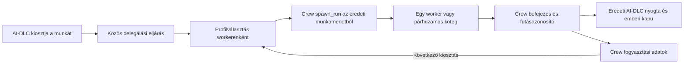

# Közös delegálás az AI-DLC és a Kiro Crew között

**2026. november 22. · Megvalósítási javaslat tulajdonosi review-ra**

**Későbbi döntés:** a közös átadási elv megmaradt. A jelenlegi ajánlás a natív Crew Decisions modellt használja, és a független reviewernél kezd. [Aktuális architektúra](NATIVE_DECISIONS_INTEGRATION.md) · [Megvalósítási terv](NATIVE_DECISIONS_IMPLEMENTATION_PLAN.md)

**Javaslat.** Legyen egy közös delegálási eljárás, amely az AI-DLC kész feladatleírásából futtatási profilt választ, a koordinátor saját munkamenetéből meghívja a Crew `spawn_run` eszközét, majd a Crew eredményét visszaköti az eredeti AI-DLC kéréshez. Az első változathoz két vagy három ellenőrzött profil és egy kis helyi szabály elég lehet. A **RossLabs** az első külső jelölt, ha a Crew-ban igazolt profilok szűréséhez és rangsorolásához ténylegesen kevesebb munkát ad. A **Downshift** a legközelebbi Crew-specifikus jelölt, eltérő bemeneti igényekkel.

Az AI-DLC adja a feladatot, a szerepet, a sorrendet, az engedélyezett hatókört, a várt kimenetet és az emberi döntési pontokat. Az illesztő kezeli a futtatási profilt, a worker indítását és az eredmény visszaadását. A Crew futtatja és méri a workert. Egy fejlesztő, egy reviewer és egy kötegnyi párhuzamos worker ugyanazt az illesztőt használhatja. Az ellenőrzés mehet lépésekben, mert minden meglévő hívónál van saját eredmény, amelynek vissza kell érnie. Az AI-DLC a saját munkamenetében végzett lépéseket közvetlenül végzi. [Munkaterv](../WORK_PLAN.md#3-what-makes-delegation-smart) · [Belépési pontok forráselemzése](research/AI_DLC_CREW_ROUTING_INTEGRATION_2026-11-22.md)

## Hol változik az AI-DLC működése?

A telepített kiadások **Crew 0.13.0**, **Kiro CLI 2.37.0 V3 relay**, **Studio 2.0.1**, a csomagban **AI-DLC 2.11.3** és a Studio kompatibilitási javításai. A korábbi élő CrewLab-próbában négy elkülönült natív Kiro-alügynök futott. Kiro és Codex közti Crew-indításokra korábbról van futási és visszatérési bizonyíték. A Kiro → Codex tesztben a Codex workert és a befejezési eseményt a rekord igazolja, a szülő Kiro beállítása a kézi próba beszámolójából ismert. A Crew-indításból visszaérkező eredmény és a Studio saját review-nyugtájának közvetlen összekötése még nincs igazolva. [CrewLab audit](CREWLAB_TRIAL_REPORT.md) · [Korábbi delegálási próbák](history/RESULTS.md) · [Studio payload](https://github.com/warren830/kirocrew-app-aidlc/blob/8b3881d4737399c3394d8d187f102a5c95d6e528/README.md#L306)

**Egy közös eljárás és több hívóhely.** A reviewer, az ensemble és a swarm protokoll a saját szövegében kéri a Kiro `subagent` eszközét. A forrásban talált közös Kiro adapter már az eszköz hívása előtt és után futó eseményeket alakítja át. Nem maga indítja a workert. A jelenlegi host által futtatott hook engedélyezi vagy elutasítja a hívást. Emiatt a megvalósítható kiindulópont egy közös Crew-skill vagy delegálási kötés, amelyre a meglévő hívóhelyek átirányíthatók. Egyetlen steering bejegyzés csak akkor elég, ha a próbákon minden érintett út következetesen azt használja. Ellenkező esetben a közös eljárásra hivatkozó rövid hívóhelyi módosításokat verziózzuk. [Reviewer kötés](https://github.com/warren830/kirocrew-app-aidlc/blob/8b3881d4737399c3394d8d187f102a5c95d6e528/payload/aidlc-kiro/.kiro/aidlc-common/protocols/stage-protocol-reviewer.md#L403) · [Kiro adapter](https://github.com/warren830/kirocrew-app-aidlc/blob/8b3881d4737399c3394d8d187f102a5c95d6e528/payload/aidlc-kiro/.kiro/hooks/aidlc-kiro-adapter.ts#L1186)

| Érintett hely | Javasolt változtatás és terjedelem |
| --- | --- |
| `integrations/aidlc-crew/` ebben a repóban | A közös eljárás skillje, a szerephez rendelt ellenőrzött profilok és a rövid választási szabály. Egy kis helyi modul indokolt, amennyiben a korrelációt és a futási adatok összesítését a Crew és a Studio meglévő rekordjai közvetlenül nem adják. |
| A célprojekt `.kiro/agents/aidlc.json` profilja és a Crew eszközhozzáférése | Célzott, támogatott beállítás a `kirocrew-core` `spawn_run` eszközének és a szükséges állapotolvasásnak. A KAS a mappaprofilból jövő MCP beállításokat szűri. A jóváhagyott Crew template-kiegészítés az egyik vizsgálandó út. A protokollszöveg önmagában nem teszi elérhetővé az eszközt. |
| A célprojekt AI-DLC Kiro kötése | Az első próba a `stage-protocol-reviewer.md` szerinti meglévő feladatot adja át. Ha később külön bekötés kell, az ensemble, a Unit/wave és a swarm a saját briefjét adja ugyanennek az eljárásnak. A kötés használja az eredeti szabályátadást, engedélyellenőrzést és lezáró parancsot. |
| `scripts/start-kirocrew.sh`, `.vscode/tasks.json` | A meglévő **Kiro Crew: Start** tölti be a szükséges közös skillt vagy konfigurációt. A launcher módosítása csak akkor szükséges, ha a támogatott Crew regisztráció nem tölti be önmagában. A későbbi külső választó helyi, verzióhoz kötött parancsként fut. |

Az első próba a fixture helyi profilján és steering beállításán keresztül próbálja ki a kötést. A Studio kezeli a csomagolt protokollfájlokat és ellenőrzi az eltérést. Ha a tartós kötéshez verziózott Studio-kompatibilitási változtatás kell, annak pontos helyét és frissítési hatását a próba eredménye alapján lehet értékelni. [KAS projektprofil és jóváhagyott kiegészítések](https://github.com/kirodotdev/KiroCrew/blob/v0.13.0/src/kiro_crew/acp/harness/kas.py#L352)

A közvetlen `spawn_run` megőrzi a koordinátor Crew-munkamenetéhez kötött visszatérést és átveszi a választott modellt és effortot. A blocking `spawn_sub_agents` közvetlenebb visszatérést kínál, de a telepített sémában előre beállított profilokra hagyatkozik. Az App Spawn SDK-nak van külön modellparamétere, a backend és az effort átadása további támogatást kívánna. A `session_create`, `work_dispatch` és Crew Workflows képes paraméterezett workert indítani, de saját munkamenet- vagy lépésállapotot hoz, amelyet hozzá kellene kötni az AI-DLC nyugtáihoz. Akkor érdemes ezekkel számolni, ha ténylegesen tartós workerre vagy a Crew lépésenkénti helyreállítására van szükség. [Futtatók összehasonlítása](research/AI_DLC_CREW_ROUTING_INTEGRATION_2026-11-22.md#meglévő-crew-indítók-összevetése)

## Az illesztés szerződése

1. **Kérés.** Az AI-DLC átadja az intentet, szakaszt, feladat- vagy review-azonosítót, szerepet, a projekt gyökerét vagy engedélyezett munkakönyvtárát, a vizsgált revíziót vagy artefaktumlenyomatot, a konkrét briefet és az elvárt kimeneti helyeket. A reviewerhez az eredeti `requestId`, `reviewFile` és `recordVerdict` kötés tartozik. A projektelemek, a betöltendő skillek és a szükséges eszközök a hatókör részei.
2. **Választás.** Az illesztő a Crew-ban látott backendek, modellek és effortok közül a feladat tényleges szerepét és jogait kiszolgáló profilokat veszi figyelembe. A feladat nehézsége, hatóköre, ellenőrizhetősége és a lehetséges újramunka adja a minőségi minimumot. Az alkalmas profilok között az eddigi fogyasztás, a kontextusigény és a rendelkezésre álló keret is számít. A tulajdonos által rögzített beállítás szűkíti a választékot. Ha egy kötelező képesség vagy jogosultság nincs igazolva, az adott jelölt kiesik. Alkalmas profil hiányában a kiosztás megnevezi a hiányzó feltételt. A kimenet a regisztrált agent, backend, modell, effort, kontextusbeállítás és rövid indok.
3. **Indítás.** Az eredeti szakaszhoz tartozó szabályátadás és az érvényes indítás előtti ellenőrzések után az AI-DLC szülője hívja a Crew-t. A választó minden taghoz önálló döntést adhat. A telepített `tasks[]` séma tagonként fogad backendet, modellt és effortot, a név szerinti agentet az egyes indítások vagy az `agents[]` tömb adja. A közös munkakönyvtárral és örökléssel rendelkező feladatok egy kötegben indíthatók. Eltérő `cwd` vagy kontextusöröklés esetén külön Crew-hívások mennek át ugyanazon az illesztőn. A párhuzamosságot és a várakozási rendet továbbra is az AI-DLC által kért topológia és a Crew sorba állítása szabja meg. [Crew séma](https://github.com/kirodotdev/KiroCrew/blob/v0.13.0/src/kiro_crew/mcp_tools/spawn_parts/schemas.py#L296) · [Crew indítások](https://kiro.dev/docs/crew/features/subagents/)
4. **Visszatérés.** Az indítás elfogadásakor a Crew azonosítóját hozzákapcsoljuk az eredeti kéréshez. A koordinátor lezárja az indító körét, hogy a Crew befejezési eseménye megérkezhessen. Az illesztő az eseményt a Crew állapotával, a szülő és a worker azonosítójával, valamint az elvárt artefaktummal ellenőrzi. A reviewer fájllenyomata a valódi lezáráshoz kötődik. Az eredeti AI-DLC naplózó és `recordVerdict` nyugta után az AI-DLC adja át a döntést az embernek. Soros feldolgozásnál ugyanezen az elven fut a meglévő pipeline nyugta. [Crew aszinkron visszatérés](https://github.com/kirodotdev/KiroCrew/blob/v0.13.0/src/kiro_crew/mcp_tools/spawn.py#L659) · [AI-DLC review lezárás](https://github.com/warren830/kirocrew-app-aidlc/blob/8b3881d4737399c3394d8d187f102a5c95d6e528/payload/aidlc-kiro/.kiro/aidlc-common/protocols/stage-protocol-reviewer.md#L182)
5. **Helyreállítás.** A várt kérésazonosító és a Crew futásazonosító párosa alapján olvassuk vissza a függő vagy befejezett állapotot. A címke segíthet az elveszett indítási nyugta megkeresésében. A címke egyedisége nem Crew-garancia. Bizonytalan indításnál előbb állapotellenőrzés kell, mert a sorba állított feladat már elfogadott munka. A hiányos vagy késői eredmény a saját kéréséhez tartozik, és csak aktuális, ellenőrzött eredménnyel lehet továbblépni.

A döntés és a futáshoz kötött nyugta a közös eljárás két része. A `subagent` híváshoz ma kötött `deliver-stage-rules` és `plan-approval-guard` ellenőrzéseknek az új indítás előtt kell érvényesülniük. A `log-subagent` műveletnek az igazi befejezéskor kell futnia. Másik toolnévre másolt PostToolUse hook a `spawn_run` azonnali nyugtája után túl korán zárna. A próba kulcsa, hogy a Crew állapotából támogatott hozzáféréssel és a munkamenetek helyes megfeleltetésével be tudjuk-e hívni az AI-DLC meglévő lezárását. [Studio adapter események](https://github.com/warren830/kirocrew-app-aidlc/blob/8b3881d4737399c3394d8d187f102a5c95d6e528/payload/aidlc-kiro/.kiro/hooks/aidlc-kiro-adapter.ts#L1376)

A skillek és eszközök a regisztrált workerprofilból jönnek. A rövid brief a feladatot, az érintett fájlokat és az ellenőrzést adja át. A Crew `include_project`, `include_memory` és `include_lessons` kapcsolóival szabályozzuk az öröklést. A független reviewer a tervet, a követelményeket és a szükséges forráshelyeket kapja meg friss kontextusban, az eredeti review fájllal mint kijelölt kimenettel. A célprojekt saját szabályait és az AI-DLC szakaszhoz szükséges előírásokat a worker bemenetében is ellenőrizni kell. [Crew kontextuskapcsolók](https://github.com/kirodotdev/KiroCrew/blob/v0.13.0/src/kiro_crew/docs/subagents.md#L30)

## Választók összevetése

A táblázat minden sora ugyanahhoz az AI-DLC és Crew átadáshoz illeszthető. Az idő a közös indításon és visszatérésen **felüli** munka. Becsült fókuszált munkanapok.

| Megoldás | Mit hoz készen? | Mi marad ránk? | Ráfordítás és megtérülés |
| --- | --- | --- | --- |
| **Két vagy három Crew-profil és helyi szabály** | Crew agentek, modelltámogatás, effort, natív indítás, futási adatok. | Pár engedélyezett szerephez profilok, egyértelmű döntési sorrend és rövid indok. Ha a koordinátori instrukció önmagában ingadozik, a választás kis függvénybe kerül. | **Benne van az első változatban. Alacsony nehézség.** Ez a legjobb kiinduló mérce és első megoldás, amíg kevés a profil. |
| **RossLabs Model Router** | Helyi JSON program. A hívó által adott jelölteket backend, képesség, kontextus, minőségi szint és támogatott effort szerint kezeli. Ismert, összehasonlítható becsléseknél rangsorol. | A Crew-profilok és a választott `preferred_effort` átadása. A helyi alapbesorolás szóalapú, így a magyar briefeknél vagy strukturált adatoknál külön összevetés kell. A fiókkeret és a futási eredmény a Crew-ból jön. | **+0,5–1 nap, alacsony vagy közepes.** Első külső jelölt. Akkor éri meg, ha több valós profilnál kivált saját szűrést vagy érdemben javít a döntésen. [RossLabs forrás](https://github.com/tyroneross/rosslabs-model-router/blob/8ec606b76333f363947b22c56c1efdc75003156e/src/lib.rs#L272) |
| **Downshift előnézet** | A `route --json` vagy az `apply` kiszámolja a javasolt modellt és effortot a kiinduló modell, szerep és szint alapján. | Crew ID-k és szintek megfeleltetése. Azonos modellnél az előnézet megőrzi a kért effortot. A teljes Crew-hookja blokkolással és újrahívással működik, amely külön fordulót jelentene. | **+0,5–1,5 nap, közepes.** Akkor éri meg, ha a projekt számára a már meglévő Downshift-szabályok vagy modellkatalógus jelentős része használható. [Downshift döntés](https://github.com/tiagovilasboas/downshift-ai/blob/13e74a26dcd583adb50fcd61cce471e45d4a825c/cmd/downshift/apply_result.go#L14) |
| **thinkdial döntési függvény** | Kockázati effortminimum, bizonyossághoz kötött váltás és azonos modellen belüli effortválasztás. | A feladat besorolása, a backend és az adott modell ténylegesen elérhető effortjai. A Crew-fogyasztást és szerepillesztést kívülről kapja. | **+0,5–1 nap, alacsony vagy közepes.** Akkor éri meg, ha az összehasonlítás szerint elsősorban az effort finomhangolása javít a minőségen vagy fogyasztáson. [thinkdial forrás](https://github.com/DmitryBMsk/thinkdial/blob/2701bac3f7ae1324f596e96e02e8f8e1e315cae4/hooks/policy.ts#L402) |
| **Crew Decisions / `light`** | Natív modellválasztás az arra alkalmas, rögzített profil nélküli Crew-futásokhoz. | A meglevő AI-DLC szerepekhez kért név szerinti indítást és a backendválasztást külön kell megadni. A telepített automatikus `model_route_derive` ezeket a futásokat kihagyja. | **Kis beállítás a megfelelő segédfeladatokhoz.** Kiegészítő, a közös választás feltételeit önmagában nem fedi. [Crew natív kiválasztás](https://github.com/kirodotdev/KiroCrew/blob/v0.13.0/src/kiro_crew/subagent_parts/model_choice.py#L83) |

Az első összevetéshez elég néhány ismert bemenet, worker indítása nélkül. Ugyanahhoz a fejlesztői szerephez egy körülhatárolt javítás ismert teszttel és egy bizonytalan, több komponenst érintő hiba azonos fiókkeret mellett eltérő profilt kaphat. A hiányzó modell vagy effort és a tulajdonos által rögzített profil külön ellenőrzési eset. Külső választót akkor érdemes átvenni, ha a Crew-adatokból használhatóbb döntést hoz, vagy mérhetően kisebb karbantartást jelent. Átvételkor rögzítsük a kiadást, tartsuk meg a forrás és a licenc megjelölését. [Korábbi jelöltek és licencek](research/AI_DLC_CREW_ROUTING_INTEGRATION_2026-11-22.md#kész-választók-és-kipróbálási-sorrend)

A részletesebb külső rangsorolók akkor kerülnek újra elő, ha már van elegendő profil és összehasonlítható mérés. A `gh-aw-router` vizsgált kiadásának tábláiból például hiányzik a Kiro/KAS, így helyi táblákkal és kalibrálással kellene kezdeni. [Rangsorolási szerződés](https://github.com/github/gh-aw-firewall/blob/v0.29.17/containers/router/README.md)

## Ráfordítás és ellenőrizhető mérföldkövek

| Lépés | Mit kell igazolni? | Becsült idő |
| --- | --- | --- |
| **A kötés megvalósíthatósága** | Az eredeti Studio-munkamenetben látszik a Crew indító. Egy elkülönült, korlátozott reviewer a megadott munkakönyvtárban elindítható. A Crew completion adatai a pontos AI-DLC kéréshez és az ismert review fájlhoz köthetők. | **0,5 napos időkeret.** A hozzáférés, a jogosultság és a hiteles lezárás a döntési pont. |
| **Első közös eljárás és profilválasztás** | Egy AI-DLC reviewer út használja a közös eljárást. Két eltérő feladat azonos keret mellett más alkalmas profilt kaphat. Egy valódi indításnál a Crew visszaigazolja a lehetőségek szerint megfigyelhető backend-, modell- és effortbeállítást. | **0,5–1 nap**, ha a kötés megvalósítható. |
| **Lezárás, fogyasztás, kapu és újraindítás** | Megvan a `reviewFile`, a megfelelő review-nyugta, a munkamenetek és run azonosítói és az elérhető fogyasztás. A következő választás megkapja a mérési összesítést. A korai továbblépési kísérletet az AI-DLC elutasítja, a fixture forrása érintetlen marad, az emberi kapu a normál újraindítás után függőben van. | **0,5–1 nap**, ha a futási rekordok összeköthetők. |
| **További hívók ugyanazon az eljáráson** | A lead vagy fejlesztő, a második backend és egy soros lánc után a párhuzamos hívás is a meglévő nyugtával tér vissza. A Unit/wave/swarm ellenőrzés korlátozott többletmunka, ha az eltérő munkakönyvtárak és jogosultságok a Crew felületén közvetlenül átadhatók. | **+1–2 nap** a második backend és az egyszerű hívók ellenőrzésére, majd **+1–2 nap** a kötegek és Unit módok igazolására. |

**Első integrált változat egy reviewerrel 1,5–2,5 munkanap.** A további hívók ugyanazon a közös eljáráson összesen **3,5–6,5 munkanapra** becsülhetők a helyi választóval és a fenti feltételekkel. Ezek külön terjedelmű eredmények. Az első próba a közös kötést igazolja, a további próbák a lefedettségét. A becslés fejlesztési idő, az emberi válaszokra várással a naptári idő hosszabb lehet. Az első integráció közepes nehézségű. A becslés felső végét a szerepjogok átadása és a futás bizonyítékának lezárása határozza meg. A teljes bevezetés a repó munkatervéhez igazodik.

Az élő próba a [korlátozott próbamenetet](NEXT_STEP.md#c-exercise-only-planning-review-and-its-user-gate) követi. Egy valódi, forrásra épülő terv és független review készül, a próba emberi jóváhagyásra várva ér véget. Az első kötelező hiba után az érintett további lépések megállnak, a bizonyítékot rögzítjük és a következő megközelítést külön egyeztetjük. [Megállási szabály](NEXT_STEP.md#stop-and-rethink-rule)

## Fogyasztás és megtérülés

Az első próba használja a Crew `spawn_status` és a már meglévő natív használati felületek elérhető adatait. A `requestId` és a Crew futásazonosító összeköti a kért és igazolt profilt, a futási időt, a mért fogyasztást, a kontextus méretét, az eredményt és a javítási köröket. Az összesítő a következő kiosztás előtt megadja az elérhető adat forrását, egységét és frissességét. A `/api/usage/turns` app számára a saját alkalmazásához rendelt sorokra szűr, ezért a hozzáférés része a próbának. A fiókkeret adata külön korlát. A Kiro-kredit, a Codex input-, output- és cache-tokenjei, a fiókkeret és a kontextusfoglalás külön mérték. Hiányzó adatot ismeretlenként jelölünk. [Crew használat futásonként](https://github.com/kirodotdev/KiroCrew/blob/v0.13.0/src/kiro_crew/dashboard/handlers/telemetry.py#L1646) · [Crew account adatok](https://github.com/kirodotdev/KiroCrew/blob/v0.13.0/src/kiro_crew/dashboard/handlers/usage.py#L705)

A korábbi, két fájlt érintő CrewLab-próbán **34,9157 Kiro-kredit** volt a kapcsolt fogyasztás. A végső kontextus **77%-át** eszközkimenetek tették ki, és egy dokumentációs feltétel nyitva maradt. Ez indokolja a kis próba és a tömörebb átadás vizsgálatát. Megtérülést akkor tudunk kimondani, ha azonos feladaton, hatókörrel és elfogadási feltételekkel az egész elfogadott munka kevesebb erőforrást igényel. A koordinátor, a worker, a review, a plusz indulási ráfordítás és az ismétlések is számítanak. A korábbi futásból a megtakarítás mértéke még nem számítható ki. [CrewLab költségaudit](CREWLAB_TRIAL_REPORT.md#6-cost-and-efficiency)

## Egyszerűbb utak, ha az illesztés drága

- **A választó túl összetett.** Marad a közös Crew átadás és két vagy három helyi profil. A célzott kontextus, az ellenőrzött effort és a Crew mérési összesítése továbbra is része a választásnak. Így a kész Crew futtatást használjuk, és csak a kis döntési logikát tartjuk karban.
- **Az indítás vagy visszatérés nem oldható meg szűk hozzáféréssel.** Külön egyeztetett, **fél–egy napos** összevetés a meglévő AI-DLC profilokkal és a natív `subagent` úttal. Azonnal használható lehet a kisebb brief és a natív fogyasztási nézet. A külön backend és a workerenkénti megfigyelhetőség ezen az úton nyitott marad.
- **Támogatott natív módosítás jelent meg.** A Kiro CLI 3.4 `updatedInput` hookja ugyanannak a toolnak a megengedett paramétereit módosíthatja. A Crew jelenlegi hostútja és a natív workerprofil ténylegesen alkalmazott modellje és effortja külön ellenőrzendő. Ha együtt működnek, Kiro workerekhez nagyon kis illesztés lehet. A Kiro és Codex közti választáshoz a Crew indítási felülete továbbra is szükséges. [Kiro hook leírás](https://kiro.dev/docs/hooks/types/#pre-tool-use)
