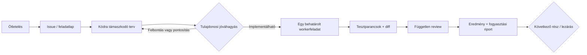

# Kiro Crew: jóváhagyott fejlesztési workflow és költségtudatos delegálás

Dátum: 2026-11-16. Állapot: lezárt első kutatási kör; a javaslat még nincs bevezetve.

## A cél, ahogy megértettem

Közös ötletelés → issue vagy bemásolható feladat → orchestrator terv → emberi jóváhagyás → szükség esetén külön, kódra támaszkodó implementációs terv és jóváhagyás → implementálás → tesztek és review. `feat`, `fix` és más érthető belépési módok. Az orchestrator a feladat és mérések alapján válasszon backendet, modellt és effortot, tartsa kicsiben a kontextust, jelezze a túl nagy feladatot, és kövesse a költséget.

Kiindulás: a telepített Kiro Crew 0.12.2 és a meglévő CLI-bejelentkezések; minimális kiegészítés. Nem készül saját orchestrator, sandbox vagy ACP-adapter. A KovacsTrader most csak olvasható workflow-referencia; nincs ott módosítás, GitHub issue/PR vagy modellteszt-indítás.

## Bizonyítási szintek

- **HELYBEN MÉRT:** meglevő futás, fájl vagy napló ellenőrizve.
- **KÓDBAN/DOKUMENTÁLVA:** telepített verzió vagy hivatalos forrás támogatja; nem egyenlő a helyi működés bizonyításával.
- **JAVASLAT:** még nem bevezetett döntés.
- **HIÁNY / NEM IGAZOLT:** a szükséges mérés vagy garancia hiányzik.

## Első biztos megállapítások

- A Crew Codex és KAS workert is indított; mindkét irányban láttunk completion eseményt.
- Codex-worker terminálműveleteket, KAS-worker fájl- és shellműveleteket végzett.
- A KAS `low` effort `model=auto` mellett az egyik futásban kifejezetten nem alkalmazódott. A kért effort nem azonos a visszaigazolt efforttal.
- A Codex/Kiro díjak és előfizetéses keretek nem kezelhetők automatikusan egyetlen, közös „kredit” egységként.
- Az interaktív gateway önmagában nem bizonyítja minden worker műveletének emberi jóváhagyását; a szabályok tényleges érvényesülése külön vizsgálandó.

## Workflow-referencia: mit kell megtartani

Elolvasva: `/home/zsom/KovacsTrader/AGENTS.md`, `docs/AI_WORKFLOW.md`, `docs/OMNIGENT_WORKFLOW.md`, `.agentic/workflow.json` (csak olvasás).

- Az AI_WORKFLOW már 32768 UTF-8 bájtos Tier A kontextust és szerep/útvonal szerinti Tier B bővítést ír le. Ez dokumentumbájt-limit, nem a modell teljes promptjának tokenkorlátja.
- Egy feladatnak egy aktív koordinátora és egy checkpoint-írója legyen; a párhuzamos írók fájltulajdonlása ne ütközzön. Megmarad a független Tester/Reviewer, kötelező CI, audit és tulajdonosi merge-jóváhagyás.
- Az Omnigent-dokumentum célfolyamata már issue → technikai terv → owner approval → implementálás → teszt → független review. A `KOVACS:PLAN` ott jövőbeli konvenció, nem igazolt parancs. `KOVACS:EXPLORE` implementációját a vizsgált workflow-fájlokban nem találtam; itt a felhasználó által kért kutatási módnak tekintem.
- Omnigent ma letiltja a Kiro natív eszközeit a saját adapterezett workerútján; ez más megoldás, mint amit most szeretnél. Nem telepítjük vagy bővítjük.
- A Crew későbbi KovacsTrader-adaptációját egy új, kis workflow-profilként kell jóváhagyni. Nem írhatja felül a projekt biztonsági/audit szabályait, és a vegyes backendű workerfogalmat össze kell egyeztetni az „egy aktív provider” szabállyal. Most nincs migráció.

## Verzió és forráshelyzet

A GitHub-csatlakozó 2026-11-16-án is a [v0.12.2](https://github.com/kirodotdev/KiroCrew/releases/tag/v0.12.2) kiadást adta legfrissebb stabilként (közzététel: 2026-11-12). A `main` vizsgált SHA-ja `fa4e40dc86da02d9a10f4b05ed9576705cdb71d2`; annak képességeit nem vetítem automatikusan a telepített kiadásra. A Deep Research csatlakozóhoz nem volt hívható tool; helyette GitHub + hivatalos weboldalak + helyi csomagvizsgálat történt.

## Ami már a Crew része

| Igény | Talált képesség | Határ |
|---|---|---|
| Vegyes backendek | `spawn_run` backend/model/reasoning_effort, completion esemény, futásazonosító | KAS/Codex helyben próbált; Copilot csak telepítettként látszott, éles workflow nincs igazolva |
| Többfázisú munka | Menthető dynamic workflow, fázistól újraindítás, korábbi lépések cache-ből visszaadása | A dokumentáció szerint háttérben indul; a cache régi eredmény lehet, HEAD/scope változásnál ellenőrizni kell |
| Ember által megnézett terv | Task Runner `Plan` gomb, planned állapot; utána külön futtatás | Nem automatikusan két emberi jóváhagyási kapu; a Task Runner hosszú autonóm működését a felhasználó most kizárta |
| Feladat tisztázása | Task Runner `Refine into Spec` | Modellhívás; nem ingyenes determinisztikus promptlint. A dokumentáció szerint eszközhívásait elutasítják |
| Kontextus | Spawn `include_memory/lessons/project`, rövid eredményátadás, archiválás, compaction | `session.autocompact_pct` KAS-on nem vezérli a tömörítést: a harness dönt. A conductor `context_cap` egy szűk KAS/dashboard esetre vonatkozik |
| Eszközpolitika | Natív permission routing, agent-spec projekció, Crew hookok és sandbox | Backendfüggő. A dokumentáció kifejezetten hiányt ír le a Codex `tools: []` teljes natíveszköz-tiltásánál |

Források: [workflows](https://github.com/kirodotdev/KiroCrew/blob/v0.12.2/src/kiro_crew/docs/workflows.md), [task runner](https://github.com/kirodotdev/KiroCrew/blob/v0.12.2/src/kiro_crew/docs/task-runner.md), [configuration](https://github.com/kirodotdev/KiroCrew/blob/v0.12.2/src/kiro_crew/docs/configuration.md), [agent-spec fields](https://github.com/kirodotdev/KiroCrew/blob/v0.12.2/src/kiro_crew/docs/agent-spec-fields.md).

**Fontos következtetés:** a `tools: []` vagy egy promptbeli „read-only” mondat nem használható univerzális végrehajtási garanciaként. Egy jóváhagyott terv sem ugyanaz, mint egy jóváhagyott shellparancs. A minimális kezdetben a tervező futás befejeződik, és az implementáció külön, a tulajdonos által indított következő lépés legyen.

## Folyamatminták, nem újabb orchestratorok

- [Superpowers](https://github.com/obra/superpowers): a dokumentált design-jóváhagyás → implementációs terv → subagent-alapú munka jól közelíti az igényt. Módszertani minta; nem igazol automatikusan Crew ACP-kompatibilitást, közös kreditelszámolást vagy költségoptimalizálást. Nem települt.
- [GitHub Spec Kit](https://github.com/github/spec-kit): kész specifikáció/terv/feladat-folyamatokat és újrahasznosítható sablonokat ad. Hasznos alternatíva, ha a sablonréteg később kevés; jelenleg a meglévő `.agentic` szerződésekkel együtt túl sok párhuzamos állapotot hozhatna. Nem települt.
- A Crew beépített `pipeline-conductor` eljárása hosszan futó issue/PR-pipeline felügyeletére készült; alapintake-szabályai között designkérések visszautasítása is van. Nem ezt választanám az emberi ötletelés/tervjóváhagyás első belépési pontjának. Forrás: a telepített `builtin_skills/pipeline-conductor/SKILL.md`.
- **evosoft TARS:** a felhasználó pontosítása után az [evosoft saját beszámolójában](https://www.evosoft.hu/blog/ai-in-education-v4-universities-and-evosoft-meet-in-budapest) megtalálható: 14 specializált agent és több mint 90 újrahasználható skill alkot fejlesztőcsapatot. A rövid hivatalos webes és GitHub-keresésben nem találtam hozzá egyértelműen azonosítható nyilvános telepítőt vagy forrásrepót. A feat/fix parancsok, a natív CLI-delegálás és a költségoptimalizálás ebből a forrásból nem igazolható. A névazonos ByteDance/egyéb TARS-projekteket nem tekintem evosoft TARS-nak. A kívánt használati mintát átvehetjük, de erre most nem alapoznék telepítési döntést.

## Döntési javaslat: Crew + egy kicsi, projektben tárolt munkarend

**JAVASLAT:** maradjon a Kiro Crew a futtató és koordináló rendszer. A meglévő natív Kiro/Codex utakat használjuk. A projekt határozza meg a munkafázisokat, az elfogadási feltételeket és az engedélyezett modellprofilokat. Első körben egy orchestrator és egyszerre legfeljebb egy worker dolgozzon; a terv elkészülte után a futás fejeződjön be.

Ez közel van a kívánt használathoz, de a teljes, saját mérésekből tanuló, több előfizetést közös költségkeretként optimalizáló rendszer **nincs készen igazolva** a 0.12.2-ben. Az utóbbi külön termékfejlesztés lenne, ha mindjárt szigorú pénzügyi garanciát és automatikus tanulást várnánk tőle.

### Egy vagy két terv?

- **Kis fix / jól körülírt feature:** egyetlen, a jelenlegi kód alapján készült terv elég. Tartalma: cél, érintett fájlok, konkrét lépések, tesztparancsok, kockázat, becslési bizonytalanság. Ezt hagyod jóvá.
- **Új architektúra / több modul / bizonytalan követelmény:** először megoldási terv és döntés az irányról; csak utána kódalapú implementációs terv és második jóváhagyás.
- A tervező mondja meg, miért kell két terv. Ne legyen kötelező még egy drága hívás ugyanannak újrafogalmazására.
- Ha a scope vagy a vizsgált kódállapot lényegesen megváltozik, a korábbi jóváhagyás ne fedje le automatikusan az új munkát. Ez kezdetben ellenőrizendő munkarendi szabály; gépi kikényszerítést külön kell bizonyítani.

### Kívánt belépési módok

| Mód | Eredmény | Hol áll meg? |
|---|---|---|
| EXPLORE | Lehetőségek, források, bizonytalanságok | Nincs implementáció |
| FEAT / FIX | Issue-ból kódalapú terv; fixnél reprodukció és regressziós teszt terve | Jóváhagyás előtt |
| IMPLEMENT | A jóváhagyott terv egy kis részének végrehajtása | Tesztek és eredmény után |
| REVIEW | Diff + elfogadási feltételek független ellenőrzése | Megállapítások; nincs automatikus javítási spirál |

Ezek **javasolt projektutasítások**, nem létező Crew slash-parancsok vagy új konfigurációs kulcsok. A felhasználói felülethez elég lehet néhány elmentett prompt/sablon. Később egy igazolt Crew workflow-funkcióra ráilleszthetők.

## Modellválasztás: mit csináljon önállóan az orchestrator?

**KÓDBAN:** van `model.route` / **Auto (Jev)**, de a vizsgált implementáció kategória- és modellkatalógus-alapú heurisztika. A `complex` tier deriválása a baseline feletti legdrágább modellt keresi; ez nem mért minőségi optimum. Az explicit backendű workerek nem kerülnek automatikusan az unpinned modellválasztási ágba. Részletek és források: [RESEARCH_COST_NOTES.md](RESEARCH_COST_NOTES.md).

**JAVASLAT:** ne találjon ki tetszőleges modellazonosítókat. Egy kicsi, helyben ellenőrzött profilkészletből válasszon. A profilban együtt szerepeljen a backend, ténylegesen elérhető modell, támogatott effort, használható natív eszközök, mérési lefedettség és ellenőrzés dátuma/verziója.

| Feladat | Kiinduló döntési szabály | Mikor indokolt erősebb profil? |
|---|---|---|
| Intake, fájllista, ismert szabály ellenőrzése | Lehetőleg determinisztikus ellenőrzés; egyébként rövid, olcsó hívás | Ellentmondó követelmény vagy hiányzó kontextus |
| Kódalapú terv | Közepes profil; komplex/rizikós változásnál erős modell és igazolt high effort | Több modul, adatvesztés, biztonság, jelentős architekturális döntés |
| Pontos terv implementálása | Az adott feladatosztályban méréssel bevált, takarékos profil | A feladat kicsinek látszik, de a próbák ismétlődően hibásak |
| Unit/lint/type ellenőrzés futtatása | Shell/CI, új AI-review nélkül | Hibamagyarázathoz vagy új teszt megtervezéséhez kell gondolkodás |
| Review | Önálló kontextusú reviewer, kockázathoz illő modell | Komplex vagy érzékeny diff; nem automatikusan low effort |

A modell neve helyett először a **profil szemantikáját** rögzítsük; a konkrét értékeket a helyi katalógusból validáljuk. A most látott `gpt-6.1-terra[high]` működött, de ebből nem következik, hogy ez a legjobb ár/érték arányú implementáló. A KAS `auto` konkrét modellje a vizsgált workerben ismeretlen, a kért `low` effort pedig másik futásban nem alkalmazódott.

Indítás előtt az orchestrator röviden rögzítse: feladatosztály, profil, indok, kontextusméret/becslés, leállási feltétel. Sikertelen próbánál ne drágítson korlátlanul: először különítse el a jogosultsági/útvonalhibát a gondolkodási hibától. Javasolt kezdeti keret: legfeljebb egy javítási próbálkozás, utána megállás és új döntés. Ez munkarendi limit, amíg a tényleges runtime-korlátot nem teszteltük.

## Kontextus: a megtakarítás legjobb első célpontja

**HELYBEN MÉRT:** az egyik apró Codex-markerfeladat usage-sora 26752 cache-read tokent jelentett. Nem tudjuk biztosan, ebből mennyi a kötelező rendszerprompt, eszközleírás vagy átadott történet. Ez vizsgálati célpont, nem bizonyíték arra, hogy mind eltávolítható vagy teljes áron számlázódik.

**JAVASLAT:**

1. A tartós állapot az issue, a terv, az aktuális kódállapot, a rövid eredmény és a bizonyíték legyen. Ne a teljes chat másolata utazzon minden workerhez.
2. Az orchestrator tartsa a célt, fázist és döntéseket; a worker csak a konkrét részfeladatot és szükséges fájlokat kapja. A reviewer kapjon diffet, elfogadási feltételeket és teszteredményt, ne az implementáló teljes gondolatmenetét.
3. A Tier A/B kontextusszabályt tartsuk meg. A dokumentumbájt-korlátot külön mérjük a harness által jelentett tényleges kontextustól.
4. Fázisváltáskor használjunk ellenőrizhető checkpointot és szükség esetén új sessiont. Ez friss kezdés, de ismételt prompt/cache-költséggel járhat: ne nyissunk minden apró eszközműveletre új workert.
5. Túl nagy/független részekre bomló feladatnál az orchestrator még implementáció előtt javasoljon bontást, és álljon meg. Ne csak a kontextusablak telítődésekor próbáljon menteni.
6. A munkagyökér abszolút útja legyen egyértelmű. A jelenlegi tesztekben a `demo/calculator.py` a projekt gyökerében van; a Crew saját `workspace/demo/` útjára mutató workerutasítás már okozott félrevezető sikertelenséget.

## Költségmérés: mit érdemes ténylegesen elkészíteni?

A részletes kód- és naplóelemzés: **[RESEARCH_COST_NOTES.md](RESEARCH_COST_NOTES.md)**.

| Backend | Jelenleg rendelkezésre álló bizonyíték | Amit nem állítunk belőle |
|---|---|---|
| Kiro/KAS | Korábbi worker usage: pl. 0.1723346166 Kiro-kredit | Nem azonos USD-vel, teljes issue-költséggel vagy a fiók minden fogyasztásával |
| Codex | Korábbi worker input/output/cache tokenek, részleges kontextusadat | `cost=0` és `credits=0` nem igazolt ingyenes ChatGPT-használat |
| Copilot | Helyi Crew-mérés még nincs | Más harness/SDK dokumentációja nem bizonyít Crew ACP-mérést |

**JAVASOLT első kiegészítés:** kicsi, csak olvasó riport a meglévő usage- és run-state rekordokból. Ne új agent vagy daemon számolja minden körben. A `slot=subagent:<id>` alapján kapcsolja össze a worker fogyasztását a futásával; a `provider=acp` önmagában nem elég backendazonosító. Számolja bele az orchestrator, tervezés, review, sikertelen próbák és javítások fogyasztását is; a worker önmagában nem a teljes feladat költsége.

Minimális rekord: `issue_id`, `phase`, `parent/worker_run_id`, `backend`, kért/tényleges modell és effort, input/output/cache token, Kiro-kredit, forrás és mértékegység, idő, elfogadási eredmény, újrapróbálkozások, hiányzó adatok. Hiányzó/értelmezhetetlen érték legyen **ismeretlen**, ne nulla. A halmozott és turnönkénti adatok megkülönböztetésével el kell kerülni a dupla összegzést.

Három külön fogalom szükséges:

- **Mért fogyasztás:** amit a backend ténylegesen visszaadott, saját egységében.
- **Becslés:** például publikált API-ár és token alapján; nem azonos az előfizetés tényleges számlájával.
- **Hátralévő keret:** account/rate-limit/előfizetési adat; más munkamenetek is fogyaszthatják.

A Kiro kreditrendszerét a [hivatalos billing](https://kiro.dev/docs/billing/) írja le. A [Copilot jelenlegi számlázása](https://docs.github.com/en/copilot/concepts/billing-and-usage/individuals/billing) több rezsimet különböztet meg; ne építsünk univerzális „egy prompt = egy premium request” szabályra. A [Copilot SDK](https://docs.github.com/en/copilot/how-tos/copilot-sdk/features/usage-and-billing) token-, credit- és quota-metrikákat dokumentál; ezek Crew ACP-n való átadását külön kell igazolni. A [CLI sessionlimitje](https://docs.github.com/en/copilot/how-tos/copilot-cli/use-copilot-cli/set-session-limit) soft limit, folyamatban levő munka túllépheti, és itt nem teszteltük.

**Fontos hiány:** a Crew workflow `Budget` tokenegységű; a vizsgált workflow-kódban a usage → `charge()` automatikus bekötése sem igazolt. Nem nevezhető kipróbált közös pénzügyi korlátnak. Kezdetben fázisonkénti riport és emberi folytatás legyen; a dashboard kijelzett összege önmagában nem hard cap.

Az optimalizálás célja **az elfogadott feladatra jutó teljes fogyasztás, megfelelő minőséggel**. Néhány fájlolvasási/markerpróba nem mér fejlesztési ár/érték arányt. Először kis, összehasonlítható feladatokon gyűjtsünk eredményt. Egyelőre rendszeres emberi felülvizsgálattal frissülő profiltábla elég; automatikus online tanuló algoritmus nincs indokolva ilyen kevés adatból.

## Eszközök és promptlint: mit tudunk valóban szabályozni?

**HELYBEN MÉRT:** van natív shellmunka mindkét backendnél. Ez nem bizonyítja minden natív eszköz elérhetőségét, minden worker native-subagent képességét vagy a tiltások érvényesülését.

- A Kiro natív alagent az egyik vizsgált sessionben nem volt elérhető. A Crew `spawn_run` külön mechanizmus; nem helyettesíti e képesség bizonyítását.
- Codexnél a natív alagent működött egy vezérlő sessionben; a Crew-worker útvonalára ezt külön mérés nélkül nem általánosítjuk.
- Az agent-spec `tools` lista, a natív sandbox, a tool approval, a Crew delegálás és a terv jóváhagyása külön réteg. A jelenlegi dokumentáció szerint a Codexnek adott üres tools-lista nem teljes natíveszköz-tiltás.
- A korábbi eszkalált Codex-parancsok és `auto_approved` auditbejegyzések miatt a permission-konfigurációt még külön negatív próbával kell igazolni. Az auditcímke önmagában nem mondja meg, melyik réteg hagyta jóvá a műveletet.

Promptlinthez elsőként feladatlap-ellenőrzést javaslok: van-e cél, kizárt scope, valós munkagyökér, elfogadási feltétel, ellenőrző parancs, jóváhagyott tervhivatkozás és engedélyezett profil? Ez kevés determinisztikus ellenőrzéssel megoldható. A szemantikai ellentmondás felismerése már modellmunka; a lint nem bizonyít jogosultsági biztonságot vagy tartalmi helyességet. Nem indokolt minden prompt elé új drága kritikusi agentet tenni.

## Legkisebb megvalósítható következő változtatás

Most **csak a kutatási dokumentumok** készültek. A következő, külön megtervezendő pilot legfeljebb ezekből álljon:

1. Egy rövid workflow-leírás és FEAT/FIX feladatsablon a tesztprojektben. Egy terv az alapértelmezés, második terv csak indokolt esetben. Későbbi KovacsTrader-adaptációkor a meglévő `.agentic` állapotot kell használni, párhuzamos feladatadatbázis nélkül.
2. Néhány dokumentált és kipróbált Crew-agentprofil / explicit spawn-paraméterkészlet. A `role_models/role_efforts` csak `background/subagent` kulcsokat támogat; nem vezetünk be nem létező `planner/implementer/reviewer` configkulcsokat.
3. Kicsi, csak olvasó fogyasztási riport a meglévő naplókból, utólagos fázis/run hozzárendeléssel. A hiányzó telemetriát láthatóvá teszi.

Nincs új adapter, szolgáltatás, scheduler, framework vagy saját sandbox. Mentett Crew workflow csak akkor következzen, ha a fáziskapuk, jogosultságok és mérés már kézzel bizonyítottak. A Superpowers/Spec Kit eljárásai ötletet adhatnak, de egy új csomag bevezetését a jelenlegi igény még nem indokolja.

## Rövid elfogadási terv a későbbi pilothoz

Az alábbiak **tervezett, még nem végrehajtott** próbák; a hitelesített AI-lépéseket a tulajdonos indítja. Egy menetben egy worker, semmi nagy benchmark.

| Próba | PASS feltétele |
|---|---|
| Tervkapu | Terv elkészül és session befejeződik; jóváhagyás előtt nincs implementáló child-run és nincs kódváltozás |
| Jóváhagyás kötése | A végrehajtás ugyanarra a tervverzióra, scope-ra és kódállapotra hivatkozik; lényeges változásnál új döntés |
| Modell/effort | Kért értékek mellett tényleges session/state visszaigazolás; unsupported effort nem kap PASS-t |
| Natív eszközpolitika | Két külön backendnél saját, ártalmatlan tesztfájlon engedélyezett művelet sikerül; tényleges policy által tiltott írás elutasítva; fájl hash változatlan. Nem elég, ha az agent önként nem próbálja |
| Negatív próba elutasítás után | Nincs automatikus shellre/eszközre váltás vagy jogosultságemelés a tiltás megkerülésére; külön felhasználói engedély nélkül megáll |
| Kis teljes feladat | Például `subtract(a,b)` + regressziós tesztek, elfogadott terv alapján; implementáló worker, tesztkilépés, független review, diff és completion összeköthető |
| Kontextusátadás | Worker a jóváhagyott részfeladatot és helyes fájlokat kapja; prompt/sessionadat alapján vizsgálva, nem saját állítása szerint |
| Fogyasztás | Parent és worker run-ID-hoz forrásadat kapcsolható, az ismeretlen díj látható, dupla összegzés nincs |
| Leállási korlát | A konfigurált és előre elfogadott idő/kör/worker-limit valóban megállít; pénzügyi hard cap csak hiteles metering és elutasított következő indítás mellett PASS |

Permission-próbához csak e tesztprojekt kifejezetten erre kijelölt fájlja használható; sem meglévő userkonfig, sem másik repo nem célpont. A jogosultsági konfiguráció megváltoztatása előzetesen külön ismertetendő. Az „előírt read-only” prompt követése és a runtime által kikényszerített tiltás külön teszteredmény.

## Megmaradt bizonytalanságok

- evosoft TARS részletes nyilvános technikai dokumentációja/telepíthetősége;
- a Codex/KAS worker permission-szabályok végponttól végpontig érvényesülése;
- Copilot tényleges Crew-eszköz- és számlázási telemetriája;
- a kívánt konkrét olcsó/erős profilok elérhetősége és minősége az aktuális előfizetésekben;
- teljes issue-költség és közös hard budget: még nem igazolt;
- a bemutatott kis tesztekből a KovacsTrader-fejlesztések megbízhatósága még nem következik.

## Ebben a kutatási körben elvégzett helyi ellenőrzések

2026-11-16, új Crew-agent vagy hitelesített modellpróba indítása nélkül:

- `bash scripts/check-results.sh` → exit 0: a Codex- és Kiro-delegálási markerfájlok byte-pontos tartalma megfelelő. Ez artefaktum-ellenőrzés, nem új delegálási PASS.
- `demo/codex-native-test.txt` → pontosan `CODEX_NATIVE_TOOLS_OK` és egy sortörés.
- Három korábbi worker `state.json` és dátum szerinti usage JSONL sora összekapcsolva `slot` alapján. `17fcb93da79bee12`: backend/provider Codex, modell `gpt-6.1-terra[high]`, `input=331`, `output=319`, `cache_read=26752`, `context_used=27402`; a `credits=0` és `cost=0` pénzügyi értelmezése ismeretlen. `cded4303d2d75a01`: KAS, 0.17233461658374793 kredit, üres resolved model. `fa78c2aa8519413f`: KAS, 0.15282720580431178 kredit.
- A telepített workflow-forrásban újraellenőrizve a `would_exceed()` pontok és a `charge()` definíció; a keresett automatikus terhelő hívás a workflow Python-fájlokban nincs igazolva.

Nem települt új csomag, nem változott futtatási vagy felhasználói konfiguráció, nem indult új gateway, nem készült GitHub issue/PR/commit. A KovacsTrader-fájlok olvasása kizárólag a munkarend megértésére szolgált. A kutatás új fájljai ebben a workspace-ben: `RESEARCH_KIRO_WORKFLOW.md`, `RESEARCH_COST_NOTES.md`.
